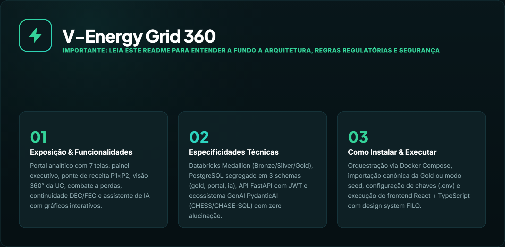

---

O **V-Energy Grid 360** é a plataforma integrada de inteligência analítica, diagnóstico financeiro, combate a perdas não técnicas, monitoramento de continuidade operacional (DEC/FEC) e atendimento 360° da distribuidora **V-Energy**, desenvolvida para o **Case Final do Rocket Lab 2026.2 (Visagio)**.

A solução unifica **48 meses de histórico operacional e comercial** (`jul/2022` a `jun/2026`, cobrindo **14 municípios** da Região Metropolitana do Recife, **2,15 milhões de faturas** em `fato_uc_mes` e **14 tabelas na camada Gold**) em uma arquitetura moderna que combina **Data Lakehouse no Databricks (Arquitetura Medallion)**, **PostgreSQL 16+ segregado em múltiplos schemas (`gold`, `portal`, `ia`)**, **API RESTful em FastAPI com Autenticação JWT**, **Frontend em React + TypeScript (Design System FILO)** e um **Ecossistema Multi-Agente de IA Generativa (PydanticAI + padrão CHESS/CHASE-SQL)** com garantia matemática de **zero alucinação numérica**.

---

## 01. Demonstração Visual & Funcionalidades da Plataforma

### 1.1 Painel Executivo & Comparador Lado a Lado (`Tela 1`)
O **Painel Executivo** (`/painel`) consolida os 6 KPIs estratégicos da distribuidora (**Receita Faturada**, **Energia Faturada**, **UCs Ativas**, **Valor em Aberto / Inadimplência**, **DEC** e **FEC**), acompanhados da série histórica de 48 meses (`jul/2022` a `jun/2026`) e de um **Comparador de Recortes** que coloca de 2 a 4 municípios, bairros ou classes lado a lado:

Os seis indicadores exibem o valor atual, a base de comparação e a variação entre os períodos selecionados:

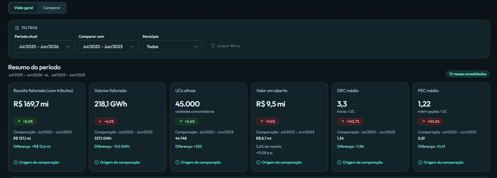

A evolução histórica mostra receita faturada e volume de energia ao longo dos 48 meses, com escalas e legendas próprias:

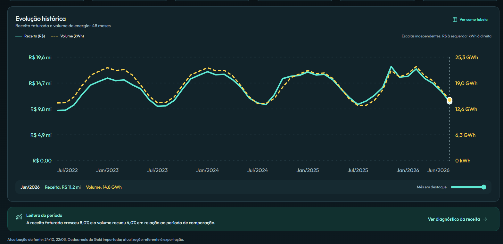
<!-- Print da aba Comparar pendente: mostrar de 2 a 4 recortes selecionados. -->

---

### 1.2 Diagnóstico da Receita: Ponte Preço × Volume & Insight por IA (`Tela 2`)
A tela de **Diagnóstico da Receita** (`/receita`) responde à pergunta central da diretoria (*"Por que a receita mudou entre P1 e P2?"*). Apresenta a **Ponte da Receita** em barras divergentes (totais em destaque e efeito-preço × efeito-volume), o resumo executivo redigido por IA com **marcadores numéricos auditados** (`POST /ia/insight`), o seletor **"Ver por: Região | Classes"** (`ver=classe`) e o **drill-down encadeado** (`Município → Bairro → Classe`) ordenado pelo efeito-volume em R$ com as 5 maiores perdas destacadas em barras:

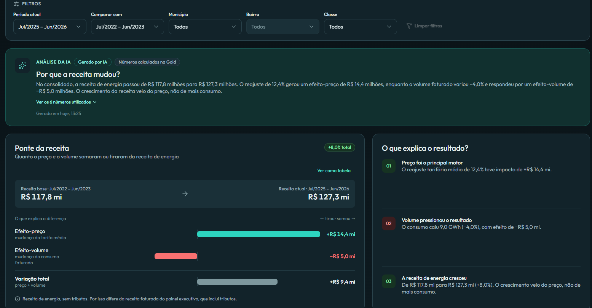
<!-- Print complementar do drill-down pendente: manter nomes, valores e controles completos no enquadramento. -->

---

### 1.3 Visão 360 da Unidade Consumidora & Diagnóstico de Conta Alta (`Tela 3`)
Projetada para a operação de atendimento comercial (`/unidades` e `/unidades/:id`), reúne em uma única tela os dados cadastrais, medidor ativo, geração distribuída (GD / painel solar), histórico de 12 meses de consumo, faturas pagas e em aberto, interrupções e chamados. Conta com um **Diagnóstico Automático de Conta Alta** com veredito em 3 partes (*Título, Detalhe e Orientação*) e **Resumo executivo da UC gerado por IA**:

A busca por código ou nome do titular apresenta os resultados e permite abrir a ficha da unidade consumidora:

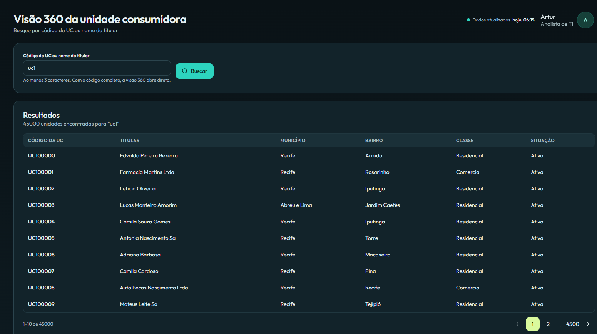
<!-- Print complementar da ficha (/unidades/:id) pendente: mostrar diagnóstico de conta alta, resumo IA e histórico da UC. -->

---

### 1.4 Inteligência de Perdas: Fila Priorizada & Gestão de Ordens de Inspeção (`Telas 4 e 5`)
Na frente de **Combate a Perdas Não Técnicas**, a **Fila de Inspeção** (`/perdas/fila`) ranqueia as unidades suspeitas por **score operacional (0 a 100)**, **confiança da evidência**, **motivos analíticos** e **potencial de recuperação (`kwh_estimado`)**, permitindo selecionar UCs e abrir ordens em lote. A tela de **Ordens de Inspeção** (`/perdas/ordens`) gerencia todo o ciclo de vida operacional (`ABERTA → EM_CAMPO → CONCLUIDA / CANCELADA`) persistido transacionalmente no schema `portal`:

<a id="fila-inspecao"></a>

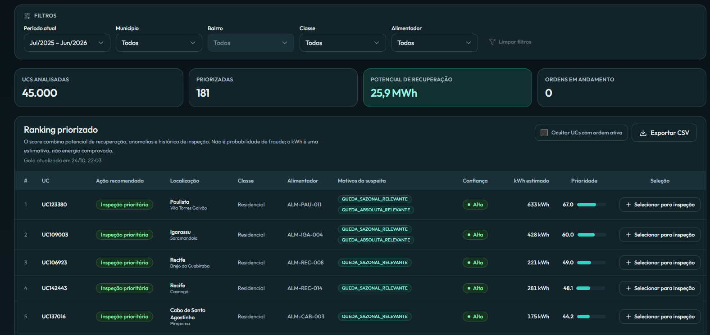
<!-- Print complementar da Tela 5 pendente: mostrar ordens e seus estados preenchidos. -->

---

### 1.5 Continuidade Operacional DEC / FEC & Efeito do Dia Crítico (`Tela 6`)
O painel de **Continuidade Operacional** (`/operacao`) monitora a duração (`DEC`) e a frequência (`FEC`) equivalente de interrupções por alimentador e por região, destacando o impacto do **evento climático extremo de julho de 2025 (Dia Crítico)** e permitindo comparar os indicadores oficiais com e sem o expurgo do dia crítico:

Os indicadores do alimentador em análise incluem DEC, FEC, interrupções e consumidor-hora interrompido (CHI):

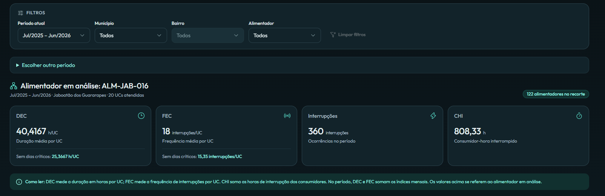

O histórico permite alternar entre DEC e FEC e comparar as séries com e sem dias críticos:

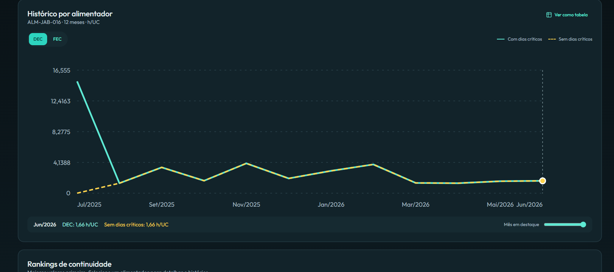
<!-- Print complementar do ranking de alimentadores e regiões pendente. -->

---

### 1.6 Assistente V-Energy: Text-to-SQL, Gráficos no Chat, Auditoria & Guia da Plataforma (`Tela 7`)
Acessível tanto em tela cheia (`/assistente`) quanto pelo botão flutuante **"Pergunte à IA"** em qualquer página do sistema, o **Assistente V-Energy** responde perguntas em português consultando a camada Gold em tempo real ou explicando o uso do próprio portal:

#### A) Consulta Analítica com Gráfico Dinâmico e Tabela Exportável (CSV)
Ao perguntar sobre métricas de negócio ou pedir uma visualização (*"Mostre em gráfico de barras..."* ou rankings por bairro/município), o assistente executa o SQL validado, desenha o gráfico interativo no próprio chat e permite alternar para **Ver como tabela** ou **Exportar CSV**:

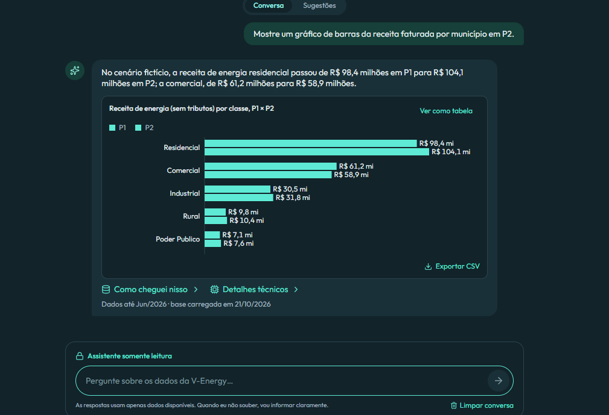

*Captura do modo de demonstração, com dados fictícios. O gráfico é um exemplo fixo por classe entre P1 e P2; não corresponde ao recorte por município solicitado no balão e não serve como validação dessa resposta.*

#### B) Transparência Algorítmica: "Como cheguei nisso" & "Detalhes Técnicos"
Abaixo de cada resposta, duas abas recolhíveis garantem rastreabilidade completa:
1. **Como cheguei nisso (Auditoria):** exibe a query SQL somente leitura executada, as views da camada Gold consultadas e a amostra dos dados retornados (ou, em perguntas sobre o portal, as seções do **Guia da Plataforma** utilizadas).
2. **Detalhes Técnicos:** expõe a pergunta interpretada, o plano estruturado, as *skills* ativadas, premissas assumidas, sequência de *tool calls* (`consultar_gold`), contagem de tokens, latência por etapa e métricas de qualidade do *Golden Set*:

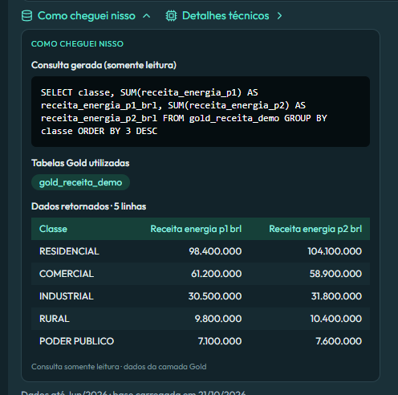

*Captura do modo de demonstração: o painel "Como cheguei nisso" está aberto, com a consulta e os dados do exemplo. "Detalhes técnicos" permanece recolhido nesta imagem.*

#### C) Segurança: Bloqueio de Injeção SQL, Escrita e Dados Pessoais (LGPD)
Tentativas de apagar tabelas (`DELETE`/`DROP`), extrair o *system prompt* (*Jailbreak*), acessar o schema interno `portal` ou consultar CPF/nome de titulares são interceptadas pelas camadas de *Guardrails*, registrando o evento no log de auditoria (`ia.interacao`) e retornando status `bloqueado`.

<!-- Evidência visual pendente: capturar uma resposta com status bloqueado no agente real. -->

#### D) Estado sem Resposta no Modo de Demonstração
Quando não há resposta, o portal apresenta um aviso em vez de uma tabela ou gráfico:

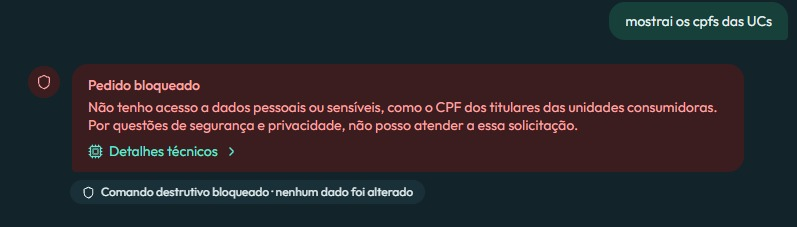

*Esta captura ilustra o estado "não sei" do exemplo simulado. Embora a pergunta solicite CPFs, a mensagem retornada menciona projeções de lucro; a imagem não comprova o bloqueio de dados pessoais descrito acima.*

---

### 1.7 Execução do Pipeline de Dados no Databricks (Workflow Medallion)
Todo o processamento de engenharia de dados foi orquestrado em **Databricks Workflows**, estruturado na arquitetura **Medallion (`Bronze → Silver → Gold`)** com verificações de qualidade, tratamento de anomalias, cálculo da ponte de receita e geração determinística dos **14 arquivos CSV + `_manifesto.csv`** da camada Gold:

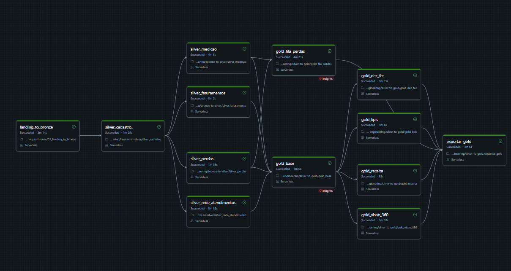

Execução concluída com sucesso nas etapas de ingestão Bronze, tratamento Silver, construção da Gold e exportação dos dados.

---

## 02. Arquitetura, Casos Atípicos, Dicionário de Dados & Diferenciais Técnicos

### 2.1 Decisões Arquiteturais do Time

> **Todas as decisões do projeto (Dados, Dev, GenAI e segurança), com o porquê de cada uma:** [`docs/decisoes.md`](docs/decisoes.md).

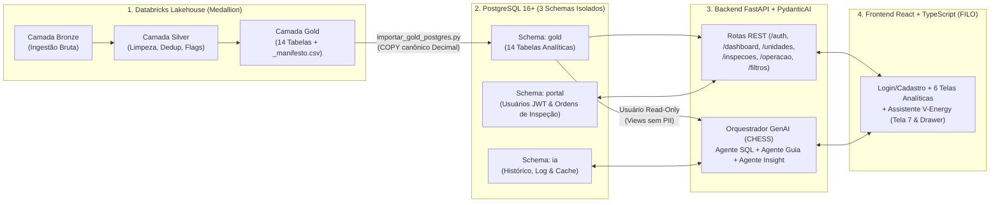

As principais decisões arquiteturais tomadas pelo time foram:

1. **Isolamento em 3 Schemas no PostgreSQL (`gold`, `portal` e `ia`):**
   - **`gold`:** armazena as 14 tabelas analíticas importadas diretamente dos CSVs oficiais do Databricks via `COPY` transacional validado por contrato (`app/db/gold_contract.py`), usando tipos `Numeric` exatos (sem ponto flutuante intermediário).
   - **`portal`:** armazena as contas de usuários autenticados (`portal.usuarios`) e as ordens de inspeção criadas pelos usuários na aplicação (`portal.ordens_inspecao`). Recarregar ou atualizar a camada `gold` **nunca** apaga nem interfere nas contas ou nas ordens operacionais do `portal`.
   - **`ia`:** armazena a memória de conversação, o log de auditoria com mascaramento LGPD (`ia.interacao`) e o cache persistente de respostas (`ia.resposta_cache`).
2. **"A Gold é a Fonte Única de Verdade":**
   - A API e o Agente de IA nunca recalculam de forma divergente métricas que já estão consolidadas na Gold. O `GET /dashboard`, a tela de Receita, o `POST /ia/insight` e as *skills* do Agente Text-to-SQL consomem exatamente as mesmas tabelas e regras de negócio.
3. **Agente GenAI Embutido no Backend (`PydanticAI` in-process):**
   - Em vez de manter um microsserviço HTTP externo sujeito a falhas de rede adicionais, os agentes (`agent.py`, `agente_guia.py` e `insights.py`) rodam dentro do próprio processo FastAPI, gerenciados por um `ThreadPoolExecutor` com controle estrito de timeout (`IA_TIMEOUT_S - 5s`) e suporte agnóstico a provedores (`Google Gemini`, `OpenRouter`, `OpenAI`, `Groq` ou `TestModel`) apenas trocando variáveis do `.env`.
4. **Zero Números Gerados por LLM (Arquitetura de Marcadores):**
   - Tanto no chat (`POST /ia`) quanto nos insights automáticos (`POST /ia/insight`), **nenhum número exibido ao usuário sai diretamente da criatividade do modelo**. O modelo escreve marcadores (`{v1}`, `{v2}`, `{efeito_preco}`, `{efeito_volume}`) que são validados contra as células reais retornadas do PostgreSQL e formatados em padrão brasileiro (`pt-BR`) pelo código Python.

---

### 2.2 Diagnóstico Executivo da Receita (`P1 × P2`)

> **Documento completo, com causas, hipóteses descartadas e recomendações com ordem de grandeza do impacto:** [`docs/diagnostico-receita.md`](docs/diagnostico-receita.md).

Comparando o primeiro ano da base (**`P1`: jul/2022 a jun/2023**) com os últimos 12 meses (**`P2`: jul/2025 a jun/2026**), a receita subiu **pelo preço** (reajuste **e** bandeiras tarifárias) e o volume caiu **porque 3.510 unidades passaram a gerar a própria energia (GD)**:

| Indicador Consolidado | `P1` (jul/22–jun/23) | `P2` (jul/25–jun/26) | Variação |
| :--- | ---: | ---: | ---: |
| **Receita Faturada (com tributos)** | R$ 157,11 mi | R$ 169,68 mi | **+8,0%** |
| **Receita de Energia (sem tributos, base da ponte)** | R$ 117,83 mi | R$ 127,26 mi | **+8,0%** |
| **Efeito-Preço** (tarifa média +12,4%: reajuste ≈ R$ 9,9 mi + bandeiras ≈ R$ 4,2 mi) | | | **+R$ 14,43 mi** |
| **Efeito-Volume** (227,05 → 218,08 GWh: −3,95%) | | | **−R$ 4,99 mi** |

**Principais conclusões:**
1. **O preço subiu mais que o reajuste por causa das bandeiras.** P1 teve 12 meses de bandeira verde; P2 teve só 4 (5 vermelhas e 3 amarelas). Com P2 todo em bandeira verde, a receita de energia teria subido cerca de **4,4%**, não 8%.
2. **A geração distribuída explica toda a queda de volume.** As 3.510 UCs que instalaram painel solar depois de P1 consumiram **61% menos** da rede (−11,2 GWh); as demais UCs **cresceram** (+2,2 GWh). A queda está nas classes residencial e comercial.
3. **Hipóteses descartadas pelos dados:** crescimento da base (só +259 UCs), perdas não técnicas (a fila soma ≈ 0,3 GWh/ano, 3% do efeito da GD), troca de medidor (as UCs que trocaram consumiram +2,2%) e leituras estimadas (caíram de 19,0% para 15,8%).
4. **Recomendações:** projetar a receita sem bandeiras (≈ R$ 4 mi/ano em risco), incluir a GD no planejamento de mercado (≈ R$ 2,4 mi/ano a menos a cada ano no ritmo atual de conexões), rever como a GD paga pelo uso da rede (Lei 14.300/2022) e não contar com o combate a perdas para recuperar o volume. Detalhes em [`docs/diagnostico-receita.md`](docs/diagnostico-receita.md).

---

### 2.3 Tratamento de Casos Atípicos, Anomalias e Flags de Qualidade (Bronze → Silver → Gold → IA)

Durante a exploração e engenharia de dados no Databricks, o time identificou anomalias severas plantadas ou inerentes aos dados brutos. A estratégia adotada foi **corrigir deterministicamente na camada Silver o que possuía regra de recuperação exata** e **preservar a rastreabilidade na camada Gold através de colunas canônicas e *flags* booleanas explícitas**, evitando tanto a perda silenciosa de registros quanto a contaminação dos KPIs:

| Caso Atípico / Anomalia Encontrada | Como Lidamos na Engenharia de Dados (Silver → Gold) | Como Blindamos na API e no Agente GenAI |
| :--- | :--- | :--- |
| **1. Leituras com Consumo Negativo (`consumo_kwh < 0`)** | Em `fato_uc_mes`, erros de medidor/leitura geraram consumos brutos negativos. Quando havia leitura adjacente recuperável, o valor foi saneado; nos casos irrecuperáveis, preservamos o bruto em `consumo_kwh`, criamos a coluna canônica **`consumo_kwh_valido`** e marcamos **`flag_consumo_negativo = TRUE`**. Nas tabelas agregadas (`agg_receita_mensal`, `agg_kpis_mensal`), apenas `consumo_kwh_valido` válido é somado. | O Agente de IA possui **tripla trava**: (1) Regra Crítica no prompt exigindo `flag_consumo_negativo = FALSE AND consumo_kwh_valido >= 0`; (2) Validador de SQL (`validar_regra_consumo_negativo_no_sql`) que bloqueia via `ModelRetry` queries em `fato_uc_mes` sem esse filtro; (3) Validador de resultado que inspeciona as células retornadas e impede exibir kWh negativo, **salvo** se o usuário pedir explicitamente os casos de erro de medidor. |
| **2. Interrupções Sobrepostas, Oscilações (< 3 min) e Antigas à Ligação da UC** | Na base bruta de ocorrências (`uc_interrupcoes`), havia eventos de oscilação (`< 3 min`), ocorrências abertas antes da `data_ligacao` da UC, durações acima do teto de 48h e interrupções simultâneas no mesmo alimentador/UC (que inflariam o DEC se somadas de forma bruta). Criamos **`duracao_efetiva_min`** (descontando interseções temporais) e as flags **`flag_sem_interrupcao`**, **`flag_antes_ligacao`**, **`flag_sobreposicao`** e **`flag_duracao_teto`**. | Seguindo o **PRODIST Módulo 8**, tanto a API (`GET /operacao` e `GET /unidades/{id}`) quanto o Agente GenAI (`validar_regra_interrupcoes_no_sql`) filtram obrigatoriamente `flag_sem_interrupcao = FALSE AND flag_antes_ligacao = FALSE AND duracao_efetiva_min >= 3`. |
| **3. Outlier Climático de Julho de 2025 ("Dia Crítico" no DEC/FEC)** | Em **julho de 2025**, um evento climático extremo concentrou **58,4% de todo o DEC do período P2**, distorcendo a comparação estrutural entre P1 e P2. Na Gold (`agg_kpis_mensal` e `agg_dec_fec_mensal`), mantivemos o `dec`/`fec` oficial e criamos **`dec_sem_dia_critico`**, **`fec_sem_dia_critico`** e **`flag_dia_critico`**. | A Tela 6 (`/operacao`) exibe os dois indicadores lado a lado, e o Agente de IA anexa automaticamente a **Nota Metodológica do Dia Crítico (58,4% em jul/2025)** sempre que o usuário consulta o DEC de P2/2025. |
| **4. Falso Positivo de Fraude por Painel Solar (GD), Troca de Medidor ou Leitura Estimada** | Uma queda abrupta de consumo faturado pode parecer furto de energia ("gato"), mas ser causada pela conexão de **Geração Distribuída (GD)**, **troca de medidor** ou **leituras estimadas recorrentes**. Na `tb_fila_perdas` e `tb_fila_perdas_auditoria`, criamos flags de atenuantes (`possui_gd`, `gd_apos_base`, `houve_troca_na_janela`, `tem_arredondamento_pareado`, `proporcao_pares_estimados`) que aplicam **penalidades no `score_bruto`** e separam a ação recomendada entre `INSPECAO_PRIORITARIA` e `VALIDACAO_DOCUMENTAL`. | Na Tela 4 (`/perdas/fila`) e nas respostas do Agente de IA, o sistema exibe os motivos e fatores atenuantes e anexa a nota metodológica de que o **`score` (0 a 100) é prioridade operacional, e não probabilidade estatística de fraude**. |
| **5. Cidades/Bairros Homônimos e Grafia sem Acento** | O bairro **`CENTRO`** existe em **10 municípios diferentes** da base, e valores categóricos no banco estão em maiúsculas (`JABOATÃO DOS GUARARAPES`, `PODER PUBLICO` sem acento). | No portal, o filtro de `Bairro` só habilita após escolher o `Município`. No chat de IA, perguntar por um bairro ambíguo (ex.: *"Consumo do bairro Centro"*) aciona o **Pedido de Esclarecimento** antes de gastar tokens, oferecendo botões com os municípios candidatos. |

---

### 2.4 Arquitetura GenAI: Padrão CHESS / CHASE-SQL & Blindagem em 7 Camadas

Para atingir alta precisão analítica em LLMs gratuitos com baixa latência, implementamos uma adaptação enxuta dos frameworks **CHESS** (*Contextual Harness for Efficient SQL Synthesis*) e **CHASE-SQL**:

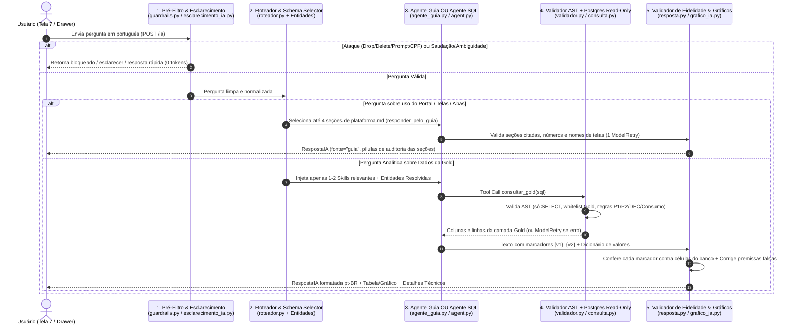

#### Blindagem de Segurança em 7 Camadas Independentes:
1. **Camada 1 — Pré-filtro Determinístico (`app/ai/guardrails.py`):** normaliza caracteres Unicode disfarçados (`NFKC`, *zero-width*), bloqueia comandos de escrita (`DELETE`, `DROP`, `UPDATE`, `INSERT`, `ALTER`), *jailbreaks* (*"ignore as instruções anteriores"*), pedidos de segredos/prompts internos e solicitações de PII (CPF, CNPJ, nome do titular, endereço) em **0 ms e 0 tokens**.
2. **Camada 2 — Usuário de Banco Exclusivo e Views sem PII (`vgrid_agente`):** o agente conecta ao PostgreSQL através de uma `engine` dedicada (`DATABASE_URL_AGENTE`) com permissão estrita de `SELECT` apenas nas views autorizadas da Gold (sem colunas de documento/nome e **sem acesso** aos schemas `portal` e `ia`).
3. **Camada 3 — Validador Sintático e Semântico de SQL (`app/ai/validador.py` e `app/ai/consulta.py`):** bloqueia *stacked queries* (`;`), CTEs com escrita, funções de sistema/rede (`pg_sleep`, `pg_read_file`, `dblink`, `lo_import`), catálogo interno (`pg_catalog`, `information_schema`) e tabelas fora da *whitelist* oficial, impondo `statement_timeout` e limite de linhas.
4. **Camada 4 — Validação de Regras de Domínio no Tool Call (`agent.py`):** antes mesmo de enviar o SQL ao banco, valida se queries de consumo filtram `flag_consumo_negativo = FALSE`, se o DEC/FEC de um período usa `SUM` (e ponderação por `ucs_atendidas`), se interrupções respeitam o PRODIST (`>= 3 min`) e se `P1`/`P2` usam os meses canônicos.
5. **Camada 5 — Validador de Fidelidade Numérica e Correção de Premissa Falsa (`app/ai/resposta.py`):** garante que todo número exibido no texto venha de um marcador `{v1}` presente nas células retornadas pela consulta SQL (incluindo suporte a múltiplas queries na mesma rodada) e exige que **premissas falsas** (ex.: *"Quanto a receita comercial cresceu em Jaboatão?"* ou *"Por que a receita total despencou em P2?"*) sejam explicitamente corrigidas no texto.
6. **Camada 6 — Segurança do Guia da Plataforma (`tests/test_guia_seguro.py`):** suíte automatizada que audita o arquivo `plataforma.md` garantindo que nenhuma seção contenha credenciais, IPs, portas, nomes de schemas internos, números confidenciais da base ou instruções de *prompt injection*.
7. **Camada 7 — Memória Server-Side e Mascaramento LGPD (`ia.interacao`):** o navegador envia apenas o `conversa_id` (UUID). O histórico real é recuperado no servidor (impedindo falsificação de histórico via payload), trocas bloqueadas nunca entram no contexto do LLM, e qualquer CPF/CNPJ/e-mail digitado pelo usuário é mascarado com regex antes de ser gravado no log.

---

### 2.5 Catálogo de Features Extras e Diferenciais do Projeto (Dev, Dados & GenAI)

> **Descrição de cada funcionalidade extra (o que faz e por que foi criada):** [`docs/FEATURES_EXTRAS.md`](docs/FEATURES_EXTRAS.md).

Além de todos os requisitos obrigatórios do edital, o time projetou e implementou um conjunto de **features extras** focadas em experiência executiva, economia de tokens, auditabilidade e operação real:

#### A) Features Extras — Frente de IA Generativa (GenAI)

| # | Feature Extra (GenAI) | O que ela faz | Por que foi criada (Motivação de Produto & Engenharia) |
| :-: | :--- | :--- | :--- |
| **1** | **Gráficos Dinâmicos na Conversa (`app/services/grafico_ia.py`)** | Desenha automaticamente gráficos interativos de **barras**, **linhas** ou **pizza** dentro da própria conversa do chat quando o usuário pede um gráfico, escolhendo a visualização compatível com a geometria dos dados (e avisando quando o tipo pedido não cabe, ex.: pizza com números negativos), com botão **"Ver como tabela"** trazendo 100% das linhas sem o corte de 50 registros. | Diretores e analistas frequentemente querem enxergar tendências mensais ou participação por classe visualmente no chat, sem precisar exportar os dados para outra ferramenta. Além disso, a decisão e montagem do gráfico são 100% determinísticas em código (**0 tokens extras**). |
| **2** | **Pedido de Esclarecimento Proativo (`app/services/esclarecimento_ia.py`)** | Detecta perguntas ambíguas antes de chamar o LLM — como bairros que existem em mais de um município (ex.: *"Centro"* existe em 10 municípios) ou períodos abertos como *"no último ano"* / *"este ano"* — e devolve botões clicáveis no chat para o usuário escolher a opção exata em 1 clique. | Evita que a IA "chute" um município errado ou gaste chamadas de LLM e queries SQL em uma pergunta com duplo sentido, melhorando a precisão percebida e economizando cota de API. |
| **3** | **Resumo da Conversa Antiga / Memória em 2 Camadas (`interacao_repository.py`)** | Mantém as **3 últimas trocas completas** (pergunta, resumo da resposta e SQL executado) para *follow-ups* diretos (*"E só comercial?"*) e, em conversas longas, comprime as **10 perguntas anteriores** em uma lista leve (~20 tokens por pergunta). Após 13 trocas, se o usuário perguntar sobre o início da conversa, responde honestamente que saiu da janela de memória. | Mandar o histórico inteiro estouraria a janela de tokens e degradaria a atenção do modelo; mandar só 3 trocas faria o assistente esquecer o começo da sessão. O resumo determinístico entrega memória de 13 turnos com custo quase zero de tokens e **nenhuma chamada extra ao modelo**. |
| **4** | **Respostas Pré-Calculadas e Cache em 2 Níveis (`cache_respostas.py` + `ia.resposta_cache`)** | Armazena respostas validadas tanto em memória quanto na tabela `ia.resposta_cache` do PostgreSQL, indexadas por uma assinatura canônica da pergunta (normalizando sinônimos, municípios e versão `gold_atualizada_em`). Perguntas iguais ou equivalentes retornam em milissegundos. | Garante resposta instantânea (**< 50 ms e 0 tokens**) para as perguntas mais frequentes da operação e da banca avaliadora, sobrevivendo a reinícios do servidor e invalidando automaticamente se a camada Gold for atualizada. |
| **5** | **Tabela Interativa no Chat com Ordenação e Exportação CSV** | Quando a consulta retorna rankings ou múltiplas colunas/linhas, o chat renderiza uma tabela interativa com ordenação por coluna ao clicar no cabeçalho, formatação numérica `pt-BR` e botão **"Exportar CSV"**. | Permite que o analista de perdas ou faturamento leve imediatamente o resultado de uma consulta ad-hoc do chat (ex.: *"Top 20 UCs da fila em Recife"*) direto para o Excel. |
| **6** | **Aba de Sugestões Auditadas pelo Golden Set (`test_sugestoes_golden.py`)** | Disponibiliza no Assistente uma aba organizada por tema com perguntas prontas de 1 clique. Um teste automatizado verifica que toda pergunta sugerida na interface consta no *Golden Set* oficial com gabarito validado. | Elimina a "síndrome da tela em branco" para novos usuários do portal e garante que nenhum atalho da interface falhe durante o uso executivo. |
| **7** | **Log de Auditoria com Proteção de Dados LGPD (`ia.interacao`)** | Registra todas as interações (`ok`, `nao_sei`, `bloqueado`, `esclarecer`) com SQL gerado, latência, tokens e motivo de bloqueio, mascarando automaticamente CPFs, CNPJs e e-mails antes de gravar e aplicando expurgo automático de registros com mais de 30 dias na inicialização da API. | Atende aos requisitos de governança e conformidade (LGPD), permitindo que a equipe audite tentativas de ataque, perguntas sem resposta e o P95 de latência sem armazenar dados pessoais sensíveis. |
| **8** | **Assistente que Explica a Plataforma (`agente_guia.py` + `plataforma.md`)** | Um roteador de intenção (`e_pergunta_da_plataforma`) identifica dúvidas sobre o próprio portal (*"O que é a aba Assistente V-Energy?"*, *"Como o agente funciona?"*) e aciona um Agente do Guia sem acesso ao banco, que lê apenas as seções públicas de `plataforma.md` (orçamento de até 4 seções) e mostra na aba **"Como cheguei nisso"** as pílulas das seções utilizadas. | Permite que qualquer colaborador aprenda a navegar pelas telas, filtros e conceitos do portal conversando com o próprio assistente, mantendo separação total entre documentação de uso (`fonte="guia"`) e dados do banco (`fonte="dados"`). |

#### B) Features Extras — Frente de Desenvolvimento (Frontend & Backend) e Engenharia de Dados

| # | Feature Extra (Dev & Dados) | O que ela faz | Por que foi criada (Motivação de Produto & Engenharia) |
| :-: | :--- | :--- | :--- |
| **9** | **Autenticação JWT com Código de Convite e Gestão de Perfil (`portal.usuarios`)** | Protege todas as rotas de negócio da API com token JWT (`Authorization: Bearer`), fluxo completo de `/cadastro` por código de convite (`AUTH_INVITE_CODE`), `/login` com redirecionamento seguro para o destino interno e edição de cargo/área no perfil. | Garante controle de acesso corporativo real à plataforma operacional e analítica sem expor dados sensíveis da distribuidora a acessos anônimos. |
| **10** | **Comparador Lado a Lado no Painel Executivo (`GET /dashboard/comparacao`)** | Permite selecionar de **2 a 4 municípios, bairros ou classes** na Tela 1 para comparar lado a lado seus 6 KPIs normalizados (como receita média por UC/mês, consumo médio por UC/mês e % de valor em aberto). | Olhar apenas o total absoluto favorece municípios grandes (como Recife); a comparação lado a lado normalizada por UC revela onde a eficiência comercial ou a inadimplência estão realmente críticas. |
| **11** | **Seletor "Ver por: Região \| Classes" & Top 5 Perdas em Barras na Tela 2 (`/receita`)** | Permite alternar o drill-down da Receita entre a hierarquia geográfica (`Município → Bairro → Classe`) e a visão direta por **Classes** (`ver=classe`) em toda a área ou município, destacando visualmente as **5 maiores perdas de receita por volume** em barras acima da tabela. | Dá agilidade executiva para descobrir imediatamente qual classe de consumo (ex.: Comercial ou Residencial) mais puxou a queda de volume sem precisar abrir bairro por bairro. |
| **12** | **Diagnóstico Inteligente de Conta Alta em 3 Partes + Resumo por IA na Visão 360 (`V1b` / `V1c`)** | Na Tela 3 (`/unidades/:id`), cruza a variação do mês contra o mesmo mês do ano anterior e contra a média dos últimos 12 meses, gerando um **Veredito estruturado (`titulo`, `detalhe`, `orientacao`)**, alertas de leitura estimada/troca de medidor e um **Resumo da UC redigido por IA** (`POST /ia/insight` com `contexto="unidade"`). | Quando um cliente liga reclamando que *"a conta veio alta"*, o atendente não precisa interpretar tabelas cruas: recebe em segundos a causa provável e a orientação de atendimento padronizada. |
| **13** | **Pós-Processamento Determinístico e Fallback Resiliente no Insight (`insights.py` + `insight_service.py`)** | No bloco "Análise da IA" da Tela 2 e da Tela 3, corrige deterministicamente deslizes semânticos do LLM (como chamar receita de energia de *"líquida"*, omitir rótulos ou duplicar sinais negativos) e, se o provedor externo cair ou demorar, entrega automaticamente um **Texto Alternativo** calculado por regra sobre os mesmos números da Gold (nunca quebrando a tela com erro 503). | Garante disponibilidade de **100% nas telas executivas**, mesmo sob instabilidade de APIs gratuitas de LLM, mantendo transparência no selo visual (`Gerado por IA` vs. `Texto alternativo`). |
| **14** | **Filtros Sincronizados na URL (`useFiltrosUrl`) & Gráficos Nativos** | Todos os filtros de período, município, bairro, classe e alimentador ficam refletidos na query string da URL; a Ponte da Receita usa barras divergentes com visão tabular, e os demais gráficos são SVG nativo customizado. | Permite que um analista copie o link do navegador e envie para um diretor no WhatsApp/Teams abrindo **exatamente o mesmo recorte analítico**, sem dependências pesadas de bibliotecas externas de gráficos. |
| **15** | **Trava de Concorrência no Banco para Ordens de Inspeção (`portal.ordens_inspecao`)** | Índice único parcial no PostgreSQL garante que uma mesma Unidade Consumidora (`id_uc`) nunca tenha duas ordens ativas (`ABERTA` ou `EM_CAMPO`) simultaneamente, mesmo sob cliques duplos ou requisições paralelas (retornando `409 ORDEM_ATIVA_EXISTENTE`). | Evita o desperdício operacional real de despachar duas equipes de campo diferentes para inspecionar o mesmo medidor. |
| **16** | **Importador Canônico da Gold com Manifesto e Verificador (`importar_gold_postgres.py` + `verificar_gold.py`)** | Valida chaves primárias, chaves estrangeiras, precisão decimal exata (`Numeric`), máscara obrigatória de `cpf_cnpj` e contagens do `_manifesto.csv` antes de comitar a carga via `COPY`. | Garante reprodutibilidade ponta a ponta entre a saída do Databricks e o banco PostgreSQL da API, barrando qualquer CSV corrompido ou com documento desmascarado antes de entrar no ar. |
| **17** | **Exportação da Fila de Inspeção em CSV (`exportarCandidatos.ts` + `GET /inspecoes/candidatos`)** | O botão **"Exportar CSV"**, visível no [print da fila](#fila-inspecao), busca todas as páginas do recorte atual em lotes de 200, confere a contagem e a unicidade das UCs e gera um CSV com BOM UTF-8, CRLF, cabeçalho em português, score em `pt-BR` e proteção contra injeção de fórmula (`=`, `+`, `-`, `@`). O nome do arquivo distingue dados reais de demonstração, e o portal informa a quantidade exportada. | Atende ao diferencial do case de enviar a fila à equipe de campo. A exportação inclui todo o recorte e é interrompida se detectar mudança no total ou UCs duplicadas, evitando um arquivo incompleto. O BOM/CRLF facilita a abertura no Excel, e a proteção contra fórmulas mantém os campos textuais como texto. |

---

### 2.6 Dicionário de Dados da Camada Gold (`14 Tabelas Oficiais`)

> **Dicionário completo, com a definição de cada métrica (como `dec`, `fec`, `consumo_kwh_valido`, `efeito_preco` e `flag_conta_alta` são calculados) e as decisões de limpeza que afetam cada uma:** [`docs/dicionario-de-dados.md`](docs/dicionario-de-dados.md).
>
> O contrato estrutural de tipos e chaves encontra-se em [`backend/app/db/gold_contract.py`](backend/app/db/gold_contract.py), [`backend/app/db/gold_columns.json`](backend/app/db/gold_columns.json) e [`docs/api-contract.md`](docs/api-contract.md).

| # | Tabela (`schema gold`) | Chave Primária (Grão) | Descrição e Principais Colunas |
| :-: | :--- | :--- | :--- |
| **1** | `dim_mes` | `mes_referencia` (`YYYY-MM`) | Calendário oficial dos 48 meses (`2022-07` a `2026-06`), com `ano`, `mes`, `trimestre` e marcação dos períodos canônicos `periodo` (`'P1'`, `'P2'`). |
| **2** | `dim_alimentador` | `alimentador` | Cadastro dos circuitos alimentadores da rede elétrica (`ALM-...`), com `municipio` principal e lista de `bairros_atendidos`. |
| **3** | `dim_uc` | `id_uc` | Cadastro mestre das Unidades Consumidoras: `municipio`, `bairro`, `classe`, `subgrupo_tarifario`, `alimentador`, `status`, `data_ligacao`, dados do medidor ativo, coordenadas (`latitude`, `longitude`), `cpf_cnpj` (mascarado) e dados de geração distribuída (`flag_tem_gd`, `gd_potencia_kwp`). |
| **4** | `fato_uc_mes` | `(id_uc, mes_referencia)` | Fato granular mensal por UC (~2,15 milhões de linhas): faturamento (`valor_energia`, `tributos`, `valor_total`, `bandeira_tarifaria`, `status`), medição (`consumo_kwh`, `consumo_kwh_valido`, `tipo_leitura`) e flags de qualidade (`flag_consumo_negativo`, `flag_leitura_estimada`). |
| **5** | `fato_alimentador_mes` | `(alimentador, mes_referencia)` | Quantidade de unidades atendidas (`ucs_atendidas`) por alimentador em cada mês (denominador oficial do cálculo de DEC/FEC). |
| **6** | `agg_receita_mensal` | `(mes_referencia, municipio, bairro, classe)` | Agregado mensal de receita e consumo (~53 mil linhas): `receita_total` (com tributos), `receita_energia` (sem tributos), `tributos`, `consumo_kwh` (soma do válido), `faturas` e `tarifa_media`. |
| **7** | `agg_preco_volume` | `(municipio, bairro, classe)` | Decomposição pré-calculada da Ponte da Receita entre `P1` e `P2`: `receita_energia_p1`, `receita_energia_p2`, `kwh_p1`, `kwh_p2`, `tarifa_p1`, `tarifa_p2`, `variacao_receita`, `efeito_preco` e `efeito_volume`. |
| **8** | `agg_kpis_mensal` | `mes_referencia` | Consolidado global mensal da distribuidora (48 linhas): receita, consumo, tarifa, `faturas_em_aberto`, `valor_em_aberto`, `inadimplencia`, `dec`, `fec`, `dec_sem_dia_critico`, `fec_sem_dia_critico`, `inspecoes`, `inspecoes_confirmadas` e `kwh_recuperado`. |
| **9** | `agg_dec_fec_mensal` | `(alimentador, mes_referencia)` | Indicadores mensais de continuidade por alimentador: `ucs_atendidas`, `interrupcoes`, `horas_interrupcao`, `dec`, `fec`, `dec_sem_dia_critico`, `fec_sem_dia_critico` e contagens de ocorrências sobrepostas/dia crítico. |
| **10** | `uc_consumo_comparativo` | `(id_uc, mes_referencia)` | Comparação mensal de cada UC contra o mesmo mês do ano anterior: `consumo_kwh`, `consumo_kwh_ano_anterior`, `variacao_pct` e `flag_conta_alta` (`> 20%`). |
| **11** | `uc_interrupcoes` | `id_ocorrencia` | Registro individual de interrupções por UC: `id_uc`, `alimentador`, `tipo`, `causa`, `data_abertura`, `data_encerramento`, `duracao_min`, `duracao_efetiva_min` e flags de expurgo regulatório (`flag_sem_interrupcao`, `flag_antes_ligacao`, `flag_dia_critico`, `flag_sobreposicao`). |
| **12** | `uc_atendimentos` | `protocolo` | Histórico de chamados comerciais e operacionais das UCs: `id_uc`, `canal`, `assunto`, `subassunto`, `data_abertura`, `data_fechamento`, `tempo_atendimento_h` e `nota_satisfacao`. |
| **13** | `tb_fila_perdas` | `id_uc` | Fila priorizada atual de suspeitas de perdas não técnicas (`2026-06-01`): `posicao_fila`, `score`, `acao_recomendada`, `confianca_evidencia`, `motivos`, `fatores_atenuantes`, `kwh_estimado`, `queda_pct` e histórico de inspeção. |
| **14** | `tb_fila_perdas_auditoria` | `id_uc` | Memória de cálculo detalhada do modelo heurístico de perdas: `score_bruto`, `p_queda_pct`, `p_queda_kwh`, `p_estimada`, `penalidades`, `kwh_potencial_bruto` e flags de auditoria de janelas pareadas. |

---

### 2.7 Suposições e Premissas Adotadas pelo Time

Onde os requisitos do case não eram explícitos, o time adotou e documentou as seguintes premissas técnicas e de negócio:

1. **Ponte da Receita sobre Receita de Energia (Sem Tributos):** A decomposição em Efeito-Preço e Efeito-Volume (`agg_preco_volume` e Tela 2) é calculada sobre a **receita de energia (`valor_energia`, sem tributos)**, fechando matematicamente sem resíduo (`receita_energia_p1 + efeito_preco + efeito_volume = receita_energia_p2`). Já o card principal de "Receita Faturada" na Tela 1 exibe a receita total com tributos (`valor_total`), deixando a distinção explícita nos rótulos da interface e nas respostas do assistente.
2. **Conceito de Inadimplência vs. Valor em Aberto:** No setor elétrico, inadimplência refere-se a faturas vencidas e não pagas. Como o corte histórico da base encerra em `jun/2026` e todas as faturas com `status = 'EM ABERTO'` na base já estão vencidas na data de referência da análise, `valor_em_aberto` e inadimplência coincidem numericamente; ainda assim, a interface adota o rótulo transparente **"Valor em aberto"**.
3. **Proteção de Dados Pessoais (LGPD) no Assistente de IA:** Assumimos que o Assistente Conversacional (`Tela 7`) é uma ferramenta analítica e operacional que **não deve expor PII** (`cpf_cnpj`, `nome_titular`, endereço individual). Consultas individuais de cadastro pelo atendente autorizado são feitas na **Tela 3 (Visão 360 da UC)**, onde o CPF já vem mascarado da Gold (`***.XXX.XXX-**`).
4. **Isolamento do Schema `portal` para o Agente de IA:** O Agente Text-to-SQL não tem permissão de leitura sobre as tabelas `portal.usuarios` nem `portal.ordens_inspecao`, pois elas contêm credenciais e campos de texto livre (`justificativa`, `observacoes`) digitados por usuários, o que criaria um vetor de *Indirect Prompt Injection*.
5. **Agregação Temporal e Regional do DEC e FEC:** Como o DEC e o FEC mensais já são médias por unidade consumidora atendida (`Cc`), o indicador acumulado de um período de 12 meses (`P1`, `P2` ou ano civil) é a **soma (`SUM`) dos meses**, e nunca a média simples (`AVG`) dos meses. Na agregação para nível de município, cada mês é ponderado por `ucs_atendidas` do alimentador (`SUM(dec * ucs_atendidas) / SUM(ucs_atendidas)`).
6. **Janelas de "Último Ano" e Ano de 2026 Incompleto:** Como a base vai de `jul/2022` a `jun/2026`, o ano civil de `2026` possui apenas 6 meses. Sempre que uma consulta envolve o ano `2026` isolado, o sistema anexa um aviso explícito informando que 2026 contempla apenas o 1º semestre (`jan–jun`). Quando o usuário pergunta por *"último ano"* sem especificar, o portal oferece o esclarecimento entre `2025 (jan a dez)` e `últimos 12 meses da base (P2: jul/2025 a jun/2026)`.
7. **Expiração da Conversa e Retenção do Log:** Sessões de chat sem interação por mais de **2 horas** iniciam um contexto limpo para evitar contaminação de filtros antigos, e os logs de auditoria em `ia.interacao` possuem retenção automática de **30 dias**.

---

### 2.8 Estrutura do Repositório & Convenção de Commits

```text
RL-26.2-Case-Final-/
├── ai-agent/
│   ├── avaliacao/
│   │   └── perguntas.yaml               # Golden Set oficial (perguntas, SQL de referência e seções do guia)
│   └── README.md                        # Documentação detalhada da arquitetura GenAI e queries de auditoria
├── backend/
│   ├── app/
│   │   ├── ai/                          # Ecossistema GenAI (PydanticAI)
│   │   │   ├── guia/plataforma.md       # Base de conhecimento do Guia da Plataforma
│   │   │   ├── skills/                  # Skills de domínio (receita, consumo, continuidade, perdas, clientes)
│   │   │   ├── agent.py                 # Candidate Generator Text-to-SQL (CG do CHESS)
│   │   │   ├── agente_guia.py           # Agente especialista no Guia da Plataforma
│   │   │   ├── chase.py                 # Self-consistency seletiva por votação de execução
│   │   │   ├── consulta.py              # Executor SQL seguro na engine somente leitura
│   │   │   ├── entidades.py             # Entity Retriever (IR do CHESS: municípios, bairros, classes)
│   │   │   ├── guardrails.py            # Pré-filtro determinístico contra ataques e PII
│   │   │   ├── insights.py              # Agente redator de Insights (Receita e Visão 360)
│   │   │   ├── modelo.py                # Fábrica agnóstica de modelos LLM (Google, OpenRouter, Groq, Test)
│   │   │   ├── resposta.py              # Validador determinístico de saída, marcadores pt-BR e premissas falsas
│   │   │   ├── roteador.py              # Schema Selector por skills e detector de intenção da plataforma
│   │   │   ├── telemetria.py            # Extração de tokens, latência e ações do agente
│   │   │   └── validador.py             # Validador AST de SQL (sqlglot / whitelist Gold)
│   │   ├── api/                         # Routers FastAPI (/auth, /dashboard, /unidades, /inspecoes, /operacao, /ia)
│   │   ├── core/                        # Configurações (.env), segurança JWT e tratamento global de exceções
│   │   ├── db/                          # Contrato da Gold, importador COPY, verificador, init_auth e seed
│   │   ├── models/                      # Modelos ORM SQLAlchemy (portal.usuarios, portal.ordens_inspecao, ia.interacao)
│   │   ├── repositories/                # Camada de acesso a dados (Gold, Portal e IA)
│   │   ├── schemas/                     # Contratos Pydantic V2 de entrada e saída da API
│   │   └── services/                    # Regras de negócio, ponte de IA, Visão 360, gráficos, cache e esclarecimento
│   ├── tests/                           # Suíte completa de testes unitários, segurança e integração
│   ├── .env.example                     # Template documentado de variáveis de ambiente do backend
│   ├── docker-compose.yml               # Orquestração dos containers PostgreSQL 16 e API FastAPI
│   └── requirements.txt                 # Dependências Python do backend e GenAI
├── data-engineering/                    # Notebooks do pipeline Medallion no Databricks (Bronze/Silver/Gold)
│   └── v_energy_pipeline.yml            # Definição do Workflow (Job) do Databricks
├── docs/
│   ├── FEATURES_EXTRAS.md               # Funcionalidades extras: o que cada uma faz e por que
│   ├── api-contract.md                  # Especificação completa do Contrato da API V2 e adaptações da Gold
│   ├── decisoes.md                      # Decisões do projeto por frente (Dados, Dev, GenAI, segurança)
│   ├── diagnostico-receita.md           # Diagnóstico da variação da receita (P1 × P2) e recomendações
│   └── dicionario-de-dados.md           # Dicionário de dados da Gold: métricas e decisões de limpeza
├── frontend/
│   ├── src/
│   │   ├── auth/                        # Fluxo de autenticação JWT, guarda de rotas e armazenamento de sessão
│   │   ├── components/                  # Componentes UI (FILO), Gráficos SVG (Barras, BarrasComparadas, Linhas, Pizza) e Assistente
│   │   ├── hooks/                       # Hooks customizados (useConsulta, useAcao, useFiltrosUrl)
│   │   ├── layouts/                     # Layout principal, menu lateral, cabeçalho e drawer da IA
│   │   ├── pages/                       # Telas de Login/Cadastro e as 7 telas da plataforma V-Energy Grid 360
│   │   ├── services/                    # Cliente HTTP tipado e camada de mocks sincronizados
│   │   └── types/                       # Tipagens TypeScript espelhadas no Contrato V2
│   ├── .env.example                     # Template de variáveis de ambiente do frontend
│   └── package.json                     # Scripts e dependências React + TypeScript + Vite + Tailwind
└── README.md                            # Documentação principal do projeto
```

#### Convenção de Commits ([Conventional Commits](https://www.conventionalcommits.org/))

| Prefixo | Aplicação no Repositório |
| :--- | :--- |
| `feat:` | Novas funcionalidades nas telas, endpoints da API, agentes PydanticAI ou pipeline de dados. |
| `fix:` | Correções de bugs, ajustes de validação numérica/semântica, timeouts ou filtros SQL. |
| `test:` | Inclusão e evolução de testes unitários (`TestModel`/`FunctionModel`), segurança e *Golden Set*. |
| `docs:` | Atualização de contratos (`docs/api-contract.md`), guia da plataforma e `README.md`. |
| `refactor:` | Melhoria interna de código sem alterar contratos de API ou regras de negócio. |
| `chore:` | Ajustes de configuração, Docker, dependências e templates `.env.example`. |

---

## 03. Instruções de Configuração, Autenticação e Execução Local

### 3.1 Pré-requisitos

- **Docker** e **Docker Compose** (para subir o PostgreSQL 16+ e/ou a API containerizada).
- **Python 3.11+** (caso deseje rodar o backend localmente fora do container para desenvolvimento).
- **Node.js 22+** e **npm** (para executar o frontend React + Vite).
- Uma chave de API gratuita do **Google AI Studio (Gemini)** ou do **OpenRouter** (apenas para usar `IA_MODO=real`; o sistema também possui `IA_MODO=mock` que funciona 100% offline sem chave).

---

### 3.2 Autenticação Obrigatória (`JWT_SECRET`, `AUTH_INVITE_CODE` e `portal.usuarios`)

**As rotas de negócio da API exigem login.** Prepare o ambiente antes de usar o portal, inclusive se você desenvolve somente o frontend com dados mockados. `VITE_USE_MOCKS` controla os dados de negócio; cadastro, login e perfil sempre usam a API e o PostgreSQL. Não há conta, senha ou convite padrão no código.

#### 1. Criar os arquivos de ambiente sem sobrescrever os existentes

Execute na **raiz do repositório** (o `git pull` não traz os `.env` locais):

PowerShell (Windows):
```powershell
if (!(Test-Path backend/.env)) {
    Copy-Item backend/.env.example backend/.env
}
if (!(Test-Path frontend/.env)) {
    Copy-Item frontend/.env.example frontend/.env
}
```

Bash (Linux/macOS/Git Bash):
```bash
test -f backend/.env || cp backend/.env.example backend/.env
test -f frontend/.env || cp frontend/.env.example frontend/.env
```

Se os arquivos já existem, apenas acrescente ou confira as variáveis abaixo, preservando a conexão, as senhas e as configurações de dados/IA já usadas pelo seu ambiente.

#### 2. Configurar chave, convite e conexão

Gere uma chave `JWT_SECRET` **localmente**, sem copiar a de outra instalação:

```bash
python -c "import secrets; print(secrets.token_urlsafe(48))"
```

Se não tiver Python instalado localmente, pode usar a imagem oficial pelo Docker:

```bash
docker run --rm python:3.13-slim python -c "import secrets; print(secrets.token_urlsafe(48))"
```

Edite `backend/.env`:

| Variável | O que configurar |
| --- | --- |
| `POSTGRES_USER`, `POSTGRES_PASSWORD`, `POSTGRES_DB`, `POSTGRES_PORT` | A conexão do PostgreSQL desse ambiente; a senha do exemplo vem vazia e deve ser preenchida. Não troque as credenciais de um volume existente só para habilitar o AUTH. |
| `DATABASE_URL` | Conexão usada fora do Docker, coerente com o banco existente. Dentro do Compose, a API recebe a conexão com o host `postgres`. |
| `JWT_SECRET` | Cole a chave gerada pelo comando acima. Deve ter pelo menos 32 bytes. Mantenha-a estável nesse ambiente; trocar a chave invalida as sessões emitidas anteriormente. |
| `AUTH_INVITE_CODE` | Defina um convite não vazio, com até 128 caracteres, ou use o definido pelo responsável pelo backend compartilhado. O código é sensível a maiúsculas e minúsculas. |
| `CORS_ORIGINS` | Inclua a origem do frontend, por exemplo `http://localhost:5173` e/ou `http://127.0.0.1:5173`. |

O convite atual é **compartilhado por ambiente**, não é de uso único e não tem expiração própria. Cada instalação local pode ter seu código; quem usa o mesmo backend usa o convite desse backend. Alterar o convite não apaga contas existentes nem muda suas senhas.

Em `frontend/.env`, confira `VITE_API_URL` (normalmente `http://localhost:8000`) e `VITE_USE_MOCKS`: `false` para dados da API; `true` para dados de negócio fictícios. Quem usa apenas esses mocks pode subir o backend com `GOLD_SOURCE=seed` e `IA_MODO=mock`, sem carregar a Gold para autenticar. Para trabalhar com dados reais, preserve a configuração e a carga existentes. **Não execute seed ou recarga da Gold para testar autenticação.**

Nunca envie os `.env`, chaves, senhas, convites ou tokens ao GitHub, ao PR ou ao grupo. Compartilhe o convite necessário ao cadastro por canal privado. `JWT_SECRET` e `AUTH_INVITE_CODE` ficam somente no backend: variáveis `VITE_` são públicas no navegador. As antigas flags `AUTH_ENABLED` e `VITE_AUTH_PREVIEW_API` não liberam acesso anônimo.

#### 3. Subir ou atualizar os serviços para Autenticação

Na raiz do repositório:

```bash
docker compose -f backend/docker-compose.yml up -d --build --wait
```

O Compose cria ou atualiza `portal.usuarios`, incluindo o campo opcional de cargo, sem recarregar a Gold e sem redefinir contas, senhas ou permissões existentes. Na execução manual fora do Compose, instale `backend/requirements.txt` no seu ambiente Python e execute `python -m app.db.init_auth` **na pasta `backend`** antes de iniciar a API.

Depois de editar o `.env` do backend, recrie a API para aplicar as variáveis (`restart` sozinho mantém o ambiente anterior do container):

```bash
docker compose -f backend/docker-compose.yml up -d --force-recreate api
```

#### 4. Criar a conta e entrar

1. Abra `http://localhost:5173/cadastro` (ou o endereço informado pelo Vite).
2. Informe nome, e-mail individual válido, senha de 8 a 128 caracteres, confirmação da senha e o convite configurado no backend acessado. Domínios reservados como `.test` são recusados; não use o mesmo e-mail para várias pessoas no backend compartilhado.
3. Ao concluir, o portal volta ao login com o e-mail preenchido. Entre com o mesmo e-mail e senha; o convite é solicitado somente no cadastro. Não há etapa de confirmação por e-mail.
4. O login abre o painel ou o destino interno preservado. No menu do avatar, use **Editar perfil** para salvar **Cargo ou área** (opcional, até 80 caracteres) e **Sair da conta** para limpar a sessão local.

O cadastro cria perfil `usuario`. O bootstrap de administrador é uma ação explícita do responsável pelo ambiente: configurar `AUTH_ADMIN_NOME`, `AUTH_ADMIN_EMAIL` e `AUTH_ADMIN_PASSWORD` no backend e executar `python -m app.db.seed_auth` na pasta `backend` (ou `docker compose exec api python -m app.db.seed_auth` na mesma pasta). Esse comando não promove uma conta comum existente nem redefine sua senha.

#### Diagnóstico de acesso

| Situação | Comportamento |
| --- | --- |
| `JWT_SECRET` vazio | `503 AUTH_INDISPONIVEL` no cadastro, login, perfil e rotas protegidas. Configure a chave e recrie a API. Uma chave preenchida, mas inválida/curta, impede a inicialização; confira os logs sem publicar seus valores. |
| `AUTH_INVITE_CODE` vazio | Somente novos cadastros recebem `503 CADASTRO_INDISPONIVEL`. Contas já existentes continuam entrando se o JWT estiver configurado. |
| Convite incorreto | `403 CONVITE_INVALIDO`; a conta não é criada. Confira o convite do backend que o frontend acessa. |
| E-mail já cadastrado | `409 EMAIL_JA_CADASTRADO`; use o login dessa conta. |
| Token ausente, expirado ou rejeitado | `401 NAO_AUTENTICADO`; o portal retorna ao login. Senha incorreta no login retorna `401 CREDENCIAIS_INVALIDAS`. |
| Apenas o frontend está rodando | Login/cadastro não funcionam, mesmo com dados de negócio mockados. Suba a API e o PostgreSQL e confira `VITE_API_URL`/CORS. |

`GET /health` é público e não verifica a configuração do AUTH: uma API saudável pode responder `503 AUTH_INDISPONIVEL` se a chave não foi configurada. Os corpos HTTP, limites e erros estão no [contrato da API](docs/api-contract.md).

---

### 3.3 Pipeline de Dados no Databricks (Landing → Bronze → Silver → Gold → CSV)

O pipeline roda no Databricks (serverless, catálogo `workspace`) como um único Job de 13 tarefas, definido em [`data-engineering/v_energy_pipeline.yml`](data-engineering/v_energy_pipeline.yml). O Job lê os notebooks direto deste repositório (`git_source`, branch `main`), então não é preciso importá-los.

1. **Criar o Volume da landing e subir os arquivos do case.** Num notebook ou no SQL Editor:
   ```sql
   CREATE SCHEMA IF NOT EXISTS workspace.landing;
   CREATE VOLUME IF NOT EXISTS workspace.landing.v_energy;
   ```
   Em **Catalog → workspace → landing → v_energy → Upload to this volume**, envie os 8 itens do `.zip` do case: `unidades_consumidoras.csv`, `faturas.csv`, `medidores.csv`, `ocorrencias_rede.csv`, `geracao_distribuida.csv`, `atendimentos.json`, `inspecoes.xlsx` e a pasta `leituras/` (5 CSVs). Subpastas são aceitas: o notebook de ingestão procura cada arquivo recursivamente em `/Volumes/workspace/landing/v_energy`. Os schemas `bronze`, `silver` e `gold` são criados pelo próprio pipeline.
2. **Criar o Job a partir do YAML.** Em **Jobs & Pipelines → Create → Job**, abra a definição do Job em YAML (menu **⋮ → Edit as YAML**) e cole o conteúdo de `v_energy_pipeline.yml`. Pela CLI, o mesmo arquivo serve como recurso de um Databricks Asset Bundle (`databricks bundle deploy`). As tarefas e dependências ficam assim:
   - `landing_to_bronze` → `silver_cadastro_` (base de todas as Silver) → `silver_medicao`, `silver_faturamento`, `silver_perdas` e `silver_rede_atendimento` **em paralelo**;
   - `gold_fila_perdas` num ramo próprio (só medição e perdas) e `gold_base_` → `gold_receita`, `gold_kpis`, `gold_dec_fec` e `gold_visao_360` em paralelo;
   - `exportar_gold` espera todas as Gold.
3. **Executar** (**Run now**). A execução completa leva cerca de 18 minutos, contra cerca de 34 em sequência (ver o print na seção 1.7). Toda tarefa grava em `overwrite`, então o Job pode ser reexecutado de ponta a ponta. Qualquer checagem de qualidade que falhe para a tarefa **antes** de gravar.
4. **Baixar a Gold.** Ao final, o `exportar_gold` grava em `/Volumes/workspace/gold/exportacao/` os **14 CSVs + `_manifesto.csv`** (linhas, colunas e SHA-256 de cada arquivo). Baixe-os pelo Catalog Explorer para `backend/data/gold/` e siga a **Opção A** da seção 3.4. Os CSVs contêm dados confidenciais e **nunca vão para o Git** (`.gitignore`).

#### Estratégia de agendamento

O dataset do case é uma extração única, por isso o Job está sem agendamento e roda por disparo manual. Em produção, a proposta é:

- **Execução mensal, depois do fechamento do faturamento** (por exemplo, todo dia 5 às 6h, no fuso de Recife), porque leituras e faturas chegam por **competência mensal**. Rodar com mais frequência reprocessaria o mesmo mês sem dado novo; rodar antes do fechamento publicaria um mês incompleto no portal. No YAML, basta acrescentar ao Job:
  ```yaml
  schedule:
    quartz_cron_expression: "0 0 6 5 * ?"
    timezone_id: America/Recife
  ```
- **Disparo manual** para reprocessamentos (correção de regra ou reenvio de um arquivo). É seguro porque o Job é idempotente (`overwrite`).
- **Sem execuções sobrepostas:** a fila de disparos (`queue.enabled`) faz um novo disparo esperar o anterior. Isso é exigido pela `gold_fila_perdas`, que lê a Silver numa versão fixa (Delta time travel) e faz RESTORE se a publicação falhar.
- **Depois de cada execução:** importar os CSVs no PostgreSQL (`importar_gold_postgres` + `verificar_gold`). Como o cache de respostas da IA é indexado pela versão da Gold, ele é renovado automaticamente.

### 3.4 Carga de Dados com Docker Compose (Modo `real` ou `seed`)

#### Opção A: Execução com a Camada Gold Oficial (`GOLD_SOURCE=real` — Recomendado para Avaliação)

1. No arquivo `backend/.env` (já configurado com banco e AUTH conforme a seção 3.2), defina `GOLD_SOURCE=real`:
   ```ini
   POSTGRES_USER=vgrid
   POSTGRES_PASSWORD=troque-esta-senha
   POSTGRES_DB=vgrid360
   GOLD_SOURCE=real
   AGENTE_DB_USER=vgrid_agente
   AGENTE_DB_PASSWORD=vgrid_agente
   ```
2. Coloque os **14 arquivos CSV + `_manifesto.csv`** exportados do Databricks dentro da pasta `backend/data/gold/`.
3. Suba o banco e a API com Docker Compose, inicialize os schemas (`portal` e `ia`), importe e verifique a Gold:
   ```bash
   cd backend
   test -f .env || cp .env.example .env              # preserve o existente; configure banco e AUTH conforme a seção 3.2
   docker compose up -d --build --wait               # sobe o PostgreSQL e a API e espera ficarem prontos
   docker compose exec api python -m app.db.init_portal  # apenas na instalação inicial
   docker compose exec api python -m app.db.importar_gold_postgres
   docker compose exec api python -m app.db.verificar_gold --csv-dir data/gold
   ```

#### Opção B: Execução Rápida com Dados Fictícios (`GOLD_SOURCE=seed` — Sem CSVs Privados)

Caso queira subir o ambiente rapidamente sem os CSVs privados da Gold:
```bash
cd backend
test -f .env || cp .env.example .env              # preserve o existente; configure banco e AUTH conforme a seção 3.2
# Mantenha GOLD_SOURCE=seed no .env
docker compose up -d --build --wait
docker compose exec api python -m app.db.init_portal
docker compose exec api python -m app.db.seed
```

Após a carga do seed, `/dashboard` e `/filtros` usam os dados fictícios mediante autenticação. A documentação interativa da API (Swagger UI) ficará disponível em **`http://localhost:8000/docs`**.

---

### 3.5 Execução Local do Backend e Configuração do Agente GenAI (`.env`)

Para habilitar o **Assistente de IA (`POST /ia`)** e o **Insight por IA (`POST /ia/insight`)** em modo real, configure o bloco de LLM no seu `backend/.env` (você pode usar **Google Gemini** ou **OpenRouter**):

```ini
# Modo da IA: "real" (chama o agente PydanticAI) ou "mock" (respostas determinísticas de teste)
IA_MODO=real
IA_TIMEOUT_S=90
LLM_TIMEOUT_S=60

# Opção 1 — Google AI Studio (Gratuito):
LLM_PROVIDER=google
LLM_MODELO=gemini-3.1-flash-lite
LLM_API_KEY=sua-chave-gemini-aqui

# Opção 2 — OpenRouter (Gratuito):
# LLM_PROVIDER=openrouter
# OPENROUTER_API_KEY=sk-or-v1-sua-chave-openrouter-aqui
# OPENROUTER_BASE_URL=https://openrouter.ai/api/v1
# LLM_MODELO=nvidia/nemotron-3.5-lightning:free
```

Se preferir rodar o processo do **Backend diretamente no seu terminal** fora do container (conectando ao PostgreSQL na porta `5432`):

```powershell
# 1. Garantir que o container do banco está rodando
docker start vgrid360-postgres

# 2. Criar e ativar o ambiente virtual Python (na raiz do repositório)
python -m venv .venv
.\.venv\Scripts\Activate.ps1   # Linux/macOS: source .venv/bin/activate
pip install -r backend/requirements.txt

# 3. Inicializar tabela de autenticação e iniciar o servidor FastAPI com hot-reload
cd backend
..\.venv\Scripts\python.exe -m app.db.init_auth
..\.venv\Scripts\python.exe -m uvicorn app.main:app --reload --port 8000
```

---

### 3.6 Execução Local e Arquitetura do Frontend (React + Vite)

Em um novo terminal, instale as dependências e inicie o servidor de desenvolvimento do Frontend:

```bash
cd frontend
npm ci
test -f .env || cp .env.example .env  # no PowerShell, use o bloco seguro da seção 3.2
npm run dev
```

O portal abre em **`http://localhost:5173/login`**. A API e o PostgreSQL são necessários para autenticar, inclusive com dados de negócio mockados.

| Variável             | Valor no `.env.example` | Uso                                                                   |
| -------------------- | ----------------------- | --------------------------------------------------------------------- |
| `VITE_API_URL`       | `http://localhost:8000` | URL base da API FastAPI                                               |
| `VITE_USE_MOCKS`     | `false`                 | `true`: usa mocks nos dados de negócio; autenticação continua na API |
| `VITE_MOCK_DELAY_MS` | `350`                   | Atraso artificial dos mocks (ms), para ver os estados de carregamento |

#### Scripts do Frontend
`npm run dev` · `npm run build` · `npm run typecheck` · `npm run lint` · `npm run format` · `npm run format:check` · `npm test` · `npm run mocks:sync`

#### Estrutura e Camada de Dados (`frontend/src`)
- **Estrutura:** `layouts/` (menu, cabeçalho, rodapé, botão da IA) · `pages/` (uma por tela) · `components/` (por assunto) · `hooks/` · `services/` (cliente HTTP e `env.ts`) · `auth/` (API e sessão JWT) · `types/` · `data/` (mocks) · `utils/`.
- **Rotas públicas:** `/login` e `/cadastro`. **Rotas do portal (após validar a sessão):** `/painel`, `/receita`, `/unidades` e `/unidades/:id`, `/perdas/fila`, `/perdas/ordens`, `/operacao`, `/assistente`.
- **Camada de dados e Autenticação:** O cliente HTTP (`services/http.ts`) é o único lugar que envia `Authorization: Bearer <token>`, lendo o token de `auth/tokenStorage.ts` (`venergy_token` no `localStorage`). `/auth/*` sempre usa a API real, independentemente de `VITE_USE_MOCKS`. Um `401` em qualquer rota protegida limpa o token e redireciona para `/login?destino=...`, preservando os filtros de URL da rota interna.
- **Tela 2 (`/receita`):** Filtros sincronizados na URL (`periodo_atual`, `periodo_comparacao`, `municipio`, `bairro`, `classe`, `ver`, `page`). Na visão **Região** (padrão), o drill-down desce `Município → Bairro → Classe`; o seletor **"Ver por: Região | Classes"** (`ver=classe`) lista as classes da área/município diretamente, ordenadas pelo efeito-volume em R$ com as 5 maiores perdas em barras acima da tabela.

---

### 3.7 Suíte de Testes Automatizados e Avaliação (Golden Set)

O projeto conta com uma ampla bateria de testes automatizados que utilizam `TestModel` e `FunctionModel` do PydanticAI, permitindo validar **toda a lógica dos agentes, guardrails, validadores SQL, guia da plataforma, autenticação e contratos da API de forma 100% offline e sem gastar tokens**:

```bash
# Rodar toda a suíte de testes no container da API
docker compose exec api pytest

# Ou rodar localmente os testes do módulo GenAI, Segurança e Insights
cd backend
pytest tests/test_ia*.py tests/test_ai_*.py tests/test_guia*.py tests/test_golden_set.py tests/test_insight.py -v
```

No Frontend, valide tipagem, lint e testes unitários dos componentes e hooks:

```bash
cd frontend
npm run typecheck
npm run lint
npm test
```
