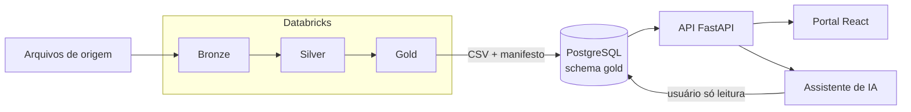
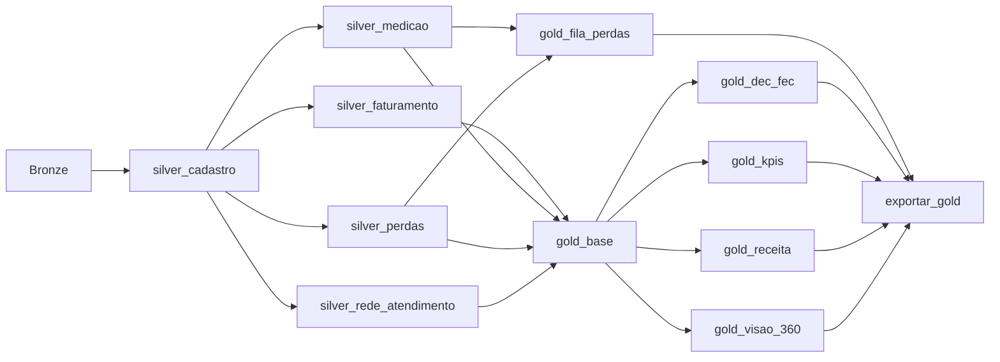

# Decisões do projeto: V-Energy Grid 360

**Rocket Lab 2026.2**

Este documento reúne as principais decisões tomadas pelo time nas três frentes do projeto: a **Engenharia de Dados**, que leva os arquivos brutos até a camada Gold; o **Desenvolvimento**, que constrói o portal sobre essa Gold; e a **GenAI**, que coloca dentro do portal um assistente que responde perguntas em português e textos de análise gerados por IA.

## Sumário

- [Visão geral da solução](#visão-geral-da-solução)
- [Os três diferenciais](#os-três-diferenciais)
- [1. Engenharia de Dados](#1-engenharia-de-dados)
- [2. Portal (Desenvolvimento)](#2-portal-desenvolvimento)
- [3. Inteligência Artificial (GenAI)](#3-inteligência-artificial-genai)
- [4. Segurança e privacidade](#4-segurança-e-privacidade)
- [5. Funcionalidades extras](#5-funcionalidades-extras)

---

## Visão geral da solução

- **Dados:** arquitetura medalhão (Bronze → Silver → Gold) no Databricks, com PySpark e tabelas Delta, orquestrada por um único Databricks Workflow (Job) reexecutável de ponta a ponta. A Gold é exportada em CSV e carregada no banco do portal.
- **Portal:** front-end em React 19 + TypeScript (Vite), back-end em FastAPI e banco PostgreSQL 16, subindo juntos com o Docker Compose.
- **IA:** agente Text-to-SQL com PydanticAI e Gemini 3.1 Flash-Lite, rodando dentro do back-end e lendo a mesma Gold que alimenta as telas.

## Os três diferenciais

Cada frente resolveu o mesmo problema de fundo, partes do sistema avançando ao mesmo tempo sem se quebrarem, com uma regra própria:

| Frente | Diferencial | Resultado |
|---|---|---|
| Engenharia de Dados | O pipeline é desenhado pelas **dependências reais de cada tabela**, e não pela ordem das camadas. Uma Silver nunca lê outra Silver. | Job de 18 min 14 s contra ~34 min em sequência: cerca de **1,9 vez mais rápido**. |
| Desenvolvimento | **Contrato da API antes do código.** Front e back dependem do contrato, e não um do outro. | Telas, consultas à Gold e integração com a IA desenvolvidas em paralelo, ligadas aos dados reais rota por rota. |
| GenAI | **O número nunca sai do modelo.** O modelo redige com marcadores; o código preenche e confere cada número no banco. | Dashboard e assistente contam a mesma história. Quando a resposta não está nos dados, o assistente diz que não sabe. |

---

## 1. Engenharia de Dados

### 1.1 Papel de cada camada

- **Bronze:** guarda os dados exatamente como vieram dos sistemas de origem.
- **Silver:** limpa, padroniza e garante a integridade entre as tabelas.
- **Gold:** consolida os dados para responder às perguntas de negócio das lideranças.

### 1.2 Bronze: preservar o original

- Os 8 arquivos do dataset são carregados como tabelas Delta sem transformação de conteúdo, inclusive o JSON aninhado dos atendimentos e as 3 abas da planilha de inspeções.
- Toda tabela recebe colunas de rastreio (`_source_file` e `_ingestion_timestamp`; nas inspeções, também `_source_sheet`), para que qualquer registro possa ser rastreado até o arquivo de origem.
- Nenhuma correção acontece nesta camada. Se uma regra de limpeza precisar mudar, basta reprocessar a Silver a partir de uma Bronze intacta.

### 1.3 Silver: um padrão de limpeza único

Com cinco pessoas limpando tabelas diferentes, o maior risco era cada uma tratar os problemas de um jeito. Por isso, definimos um **Padrão de Limpeza** seguido por todos os notebooks da Silver.

**Os 9 passos de todo notebook:** carregar as funções comuns → ler e contar → estrutura → tipos → domínios → duplicatas → consistência → integridade → checagens e reconciliação antes de gravar → gravar Silver, quarentena e log.

**Regras principais:**

- **Todo problema tem um destino documentado:** é corrigido, vai para a quarentena (com o motivo registrado) ou vira uma flag. Nenhum registro some sem explicação.
- **A integridade referencial vem por último**, depois que os dados já estão limpos, para que uma chave mal formatada não seja confundida com um registro órfão.
- **As checagens rodam antes de gravar:** se uma garantia da limpeza falha (unicidade, nulos, domínio, reconciliação de contagens), o notebook para em vez de gravar dados errados.
- **Nada de conversão direta de tipos:** todo campo passa por uma função de parse seguida de uma checagem, para que valores que não converteram não virem nulos silenciosamente.
- **Valores-sentinela são tratados como ausência de valor**, de forma explícita (ex.: `-1` e `9999-12-31`).
- **Toda execução grava um log** com as contagens de cada problema encontrado, o que permite auditar a limpeza e responder "quantos registros essa regra afetou".

**Funções comuns.** Toda lógica usada por dois ou mais notebooks foi para um notebook compartilhado (`funcoes_comuns`), com o mecanismo no código comum e a regra de negócio passada como parâmetro. Isso garantiu o mesmo comportamento em todas as tabelas e evitou cinco versões diferentes da mesma correção.

### 1.4 Decisões de limpeza que afetam os números do negócio

| Tabela | Decisão |
|---|---|
| Cadastro | De 46.461 linhas para **45.000 UCs**, removendo duplicatas e 200 registros de teste, que foram para a quarentena. O cadastro limpo é a referência de todas as outras tabelas e o denominador do DEC e do FEC. |
| Faturas | 32.285 faturas órfãs (com identificador de UC inexistente) foram para a quarentena. As faturas "EM ABERTO" com data de pagamento tinham, na verdade, uma data-sentinela; mantivemos o status e tratamos a data como ausente. |
| Leituras | 8.609 leituras de medidores inexistentes foram para a quarentena. A maior parte dos consumos negativos era a primeira leitura após uma troca de medidor (a leitura anterior era do medidor antigo). Em vez de descartá-los, recalculamos o consumo e marcamos com flag, preservando cerca de 2,4 GWh que seriam perdidos no último ano da base. |
| Medidores | A data de retirada `9999-12-31` significa "ainda instalado", e não uma irregularidade. As aparentes UCs com mais de um medidor ativo eram duplicatas. |
| Rede | Causas vazias viraram "NÃO INFORMADA", separada de "NÃO IDENTIFICADA". Interrupções com duração no teto e interrupções sobrepostas receberam flags, para não inflarem o DEC. |

### 1.5 Gold: modelada pelas perguntas de negócio

- **Uma base comum primeiro.** A `gold_base` monta o que é compartilhado por todas as outras tabelas: as dimensões de mês, UC e alimentador e o fato mensal por UC.
- **Uma métrica, um lugar.** Cada indicador é calculado em uma única tabela. Nenhuma Gold recalcula o que já existe em outra, o que evita dois números diferentes para a mesma pergunta.
- **Problema de dado volta à Silver.** Se uma inconsistência é encontrada na Gold, a correção é feita na Silver pelo dono da tabela, e não remendada na Gold.
- **Uma tabela (ou conjunto) por necessidade do portal:** receita e efeito preço × volume, KPIs, DEC e FEC por alimentador, fila de perdas e visão 360 da UC.
- **Privacidade:** CPF e CNPJ são mascarados já na Gold, antes de chegarem ao portal e ao agente de IA.

### 1.6 Exportação para o banco do portal

- As 14 tabelas Gold de interesse do portal são exportadas em CSV, como pede o case, com um arquivo por tabela.
- Junto, é gerado um **manifesto** com o número de linhas, as colunas e o hash (SHA-256) de cada arquivo. Antes de gravar, o notebook confere que cada CSV tem exatamente as mesmas linhas da tabela de origem.
- O back-end carrega os CSVs no PostgreSQL numa única transação e confere as contagens contra o manifesto (ver [2.4](#24-banco-e-carga-da-gold)). Assim, o portal nunca fica com uma carga pela metade.
- Os CSVs não vão para o repositório, que é público.

### 1.7 Diferencial: a paralelização do pipeline

No jeito mais comum de implementar a arquitetura medalhão, as etapas rodam em sequência: uma tabela de cada vez, ou uma camada inteira de cada vez. Nós desenhamos o pipeline a partir das **dependências reais de cada tabela**, e não da ordem das camadas. Com isso, tudo o que não depende entre si roda ao mesmo tempo.

**Como fizemos**

1. **O cadastro como única referência da Silver.** O `silver_cadastro` roda primeiro, logo após a Bronze, porque é a fonte de verdade das unidades consumidoras. Todas as outras Silver dependem apenas dele, que é a referência para separar faturas e leituras órfãs.
2. **Uma Silver nunca lê outra Silver.** Essa foi a regra que tornou a paralelização possível. Como faturamento, medição, perdas e rede/atendimento não dependem umas das outras, as **quatro rodam ao mesmo tempo** assim que o cadastro termina.
3. **A Gold em dois ramos independentes.**
   - **Ramo da fila de perdas:** a `gold_fila_perdas` depende apenas da medição e das perdas. Ela começa assim que essas duas Silver terminam, sem esperar faturamento, rede ou a `gold_base`. Como é a tarefa mais longa do pipeline, tirá-la do caminho da base faz diferença no tempo total.
   - **Ramo da base:** a `gold_base` espera as quatro Silver e, a partir dela, as Gold de DEC/FEC, KPIs, receita e visão 360 rodam **em paralelo**.
4. **A exportação como ponto de encontro final.** O `exportar_gold` só começa quando todas as Gold terminam, garantindo que os CSVs sempre representem uma versão completa e consistente da Gold.

**Resultado**

A última execução completa do pipeline levou **18 min 14 s**. Somando o tempo de cada uma das 13 tarefas, a mesma execução rodando em sequência levaria cerca de **34 minutos**. O desenho paralelo deixa o pipeline aproximadamente **1,9 vez mais rápido**, com cerca de 16 minutos a menos por execução.

O tempo total do pipeline paralelo é definido pelo seu **caminho crítico**, a sequência mais longa de tarefas que dependem umas das outras: Bronze → cadastro → medição → fila de perdas → exportação. Isso também mostra onde está o próximo ganho: otimizar a medição e a fila de perdas, as duas tarefas mais longas desse caminho.

> O tempo sequencial é uma estimativa feita a partir das durações medidas na execução paralela.

**Um ganho também para o time.** A mesma regra que permitiu ao Databricks rodar as tabelas em paralelo permitiu ao time trabalhar em paralelo. Como cada Silver depende só do cadastro e tem um único dono, cinco pessoas desenvolveram suas tabelas ao mesmo tempo, sem esperar umas pelas outras. As funções comuns e o Padrão de Limpeza garantiram que, mesmo trabalhando separadamente, todos entregassem tabelas com o mesmo nível de qualidade.

---

## 2. Portal (Desenvolvimento)

### 2.1 Arquitetura

O portal é uma aplicação web em três partes, que sobem juntas com o Docker Compose:

- **Front-end:** SPA em React 19, com Vite, Tailwind CSS 4 e React Router 7, escrita em TypeScript.
- **Back-end:** API em FastAPI (Python), com Pydantic v2 na validação e SQLAlchemy 2 no acesso ao banco.
- **Banco:** PostgreSQL 16, que recebe a Gold exportada pela Engenharia de Dados e guarda os dados próprios do portal.

O banco é dividido em quatro schemas, cada um com um papel bem definido:

| Schema | Papel |
|---|---|
| `gold` | As tabelas da camada Gold, somente para leitura. É a fonte de verdade de todos os números do portal. |
| `portal` | O que nasce no uso do portal, como as ordens de inspeção e os usuários. |
| `ia` | O histórico das conversas com o assistente e o log de auditoria. |
| `agente` | O acesso restrito do agente de IA, com um usuário de banco que só consegue ler. |

### 2.2 Contrato primeiro: a API como acordo do time

Com front-end, back-end, dados e IA avançando ao mesmo tempo, o maior risco era cada parte assumir um formato diferente para a mesma informação. Por isso, antes de escrever as telas e as consultas, escrevemos o contrato da API (`docs/api-contract.md`).

- **Versões:** a V1 nasceu das telas do case; a V2 foi reescrita depois de conhecermos a Gold, com os nomes, tipos e períodos exatamente como estão nas tabelas.
- **Formato único:** todas as rotas seguem as mesmas regras de filtros, períodos (`AAAA-MM`), paginação e erros, com um código de erro, uma mensagem e os detalhes.
- **Stubs e fixtures:** cada rota começou devolvendo um exemplo fixo, igual ao do contrato. O front pôde ser construído sobre esses exemplos enquanto as consultas reais eram escritas.
- **Mocks validados:** os dados de exemplo do front são conferidos automaticamente contra os schemas da API. Se alguém muda um formato no back-end sem atualizar o front, o teste falha.
- **Uma mudança, um PR completo:** quem muda o formato de uma rota atualiza no mesmo PR o contrato, o schema, os exemplos, os tipos do front e os testes.

### 2.3 Back-end: camadas e regras comuns

Todo endpoint segue o mesmo caminho em três camadas, para que qualquer pessoa do time saiba onde procurar cada coisa:

- **Router:** recebe a requisição, valida os parâmetros e devolve a resposta. Não tem regra de negócio.
- **Service:** aplica as regras de negócio e monta a resposta no formato do contrato.
- **Repository:** é o único lugar que escreve SQL e conversa com o banco.

Regras que valem para toda a API:

- **Os dados não podem ser alterados; nós nos adaptamos a eles.** A Gold é a fonte de verdade. Quando um número parecia estranho, a correção foi pedida à Engenharia de Dados, e não remendada na API (a mesma regra da [seção 1.5](#15-gold-modelada-pelas-perguntas-de-negócio)).
- **A API entrega os números prontos.** Variações, totais e indicadores são calculados no back-end; o front só formata. Assim, a tela e o assistente nunca mostram dois valores diferentes para a mesma pergunta.
- **Entrada estrita:** os schemas recusam campos que não existem no contrato (erro 422), em vez de ignorá-los em silêncio.
- **Filtros consistentes:** os filtros geográficos se combinam (município, bairro, classe e alimentador), e o bairro sempre exige o município, porque o mesmo nome de bairro existe em mais de uma cidade.
- **Dois modos de dados:** com `GOLD_SOURCE=seed`, a API usa dados fictícios para desenvolvimento e testes; com `GOLD_SOURCE=real`, lê a Gold carregada. Toda resposta informa se os dados são fictícios e a data da carga da Gold.

### 2.4 Banco e carga da Gold

- **Carga em uma única transação:** o importador lê os CSVs da Gold e confere linhas e colunas contra o manifesto gerado pela Engenharia de Dados. Se algo não bate, nada é gravado, e o portal nunca fica com uma carga pela metade.
- **Verificação depois da carga:** um verificador confere chaves, tipos numéricos exatos e a máscara de CPF e CNPJ antes de a Gold ser usada.
- **Desempenho:** criamos um índice para o cálculo do valor em aberto e rodamos o `VACUUM ANALYZE` ao final de cada carga, para o PostgreSQL ter estatísticas atualizadas das tabelas novas.
- **Dados privados fora do repositório:** os CSVs da Gold e as credenciais ficam só na máquina de cada pessoa (`.env`). O repositório, que é público, guarda apenas o código e os dados fictícios.

### 2.5 Regras de negócio decididas na implementação

Algumas perguntas só apareceram ao ligar as telas aos dados reais. Cada uma foi decidida pelo time e registrada no contrato:

| Regra | Por quê |
|---|---|
| Uma UC inspecionada nos últimos 6 meses sai da fila de perdas. | Evita mandar uma equipe de novo a um local que acabou de ser vistoriado. |
| Uma UC só pode ter uma ordem ativa (aberta ou em campo). | Um índice único no banco garante isso mesmo com cliques duplos ou pedidos simultâneos; a API responde 409. |
| Ordens em lote são criadas no modo tudo-ou-nada. | Se uma ordem do lote falha, nenhuma é criada, e o usuário não fica com um lote pela metade. |
| O resultado das inspeções compara kWh por mês. | A estimativa da fila cobre vários meses, e o campo informa um mês; dividir pelo mesmo período torna os dois números comparáveis. |
| O ranking da receita é ordenado pela perda por volume. | É a pergunta da tela: onde o volume caiu. A perda por preço aparece ao lado, sem mudar a ordem. |
| Efeito ausente na decomposição vale zero. | Assim a ponte da receita e o drill-down sempre fecham com o total, sem erro na tela. |
| Fora da decomposição da Gold, a ponte e o drill-down vêm vazios. | Os KPIs continuam aparecendo; só a parte que depende da decomposição avisa que não se aplica. |

### 2.6 Front-end: telas previsíveis

- **Uma camada de serviços espelha o contrato:** os tipos TypeScript e as funções de chamada à API seguem os mesmos nomes do contrato, e o modo mock (`VITE_USE_MOCKS`) troca a API pelos exemplos sem mudar nenhuma tela.
- **Hooks comuns:** `useConsulta` busca os dados e mantém o resultado anterior enquanto recarrega, para a tela não piscar; `useAcao` trata envios como criar ou concluir ordens; `useFiltrosUrl` guarda os filtros na URL.
- **Filtros na URL:** copiar o link do navegador abre exatamente o mesmo recorte para outra pessoa.
- **Gráficos próprios em SVG:** a cascata da receita e as barras foram desenhadas sem biblioteca externa, com dica ao passar o mouse e uma versão em tabela para leitores de tela.
- **Acessibilidade e temas:** componentes com rótulos e foco corretos, navegação por teclado nos modais e tema claro e escuro em todas as telas.

### 2.7 Integração com o assistente de IA

O lado do portal na integração com a IA (o funcionamento do agente está na [seção 3](#3-inteligência-artificial-genai)):

- **Um endpoint para o chat (`POST /ia`):** a resposta sempre traz o texto, o SQL usado, as tabelas consultadas, os dados e a data da Gold, para o usuário conferir de onde veio cada número.
- **Roteador de intenção na entrada:** a pergunta é classificada por código antes de chamar o modelo, e só as perguntas de dados vão para o agente.
- **Dois modos de IA:** com `IA_MODO=mock`, as respostas são fixas, para desenvolver e testar sem gastar tokens; com `IA_MODO=real`, o modelo é chamado.
- **A tela não quebra se o modelo cair:** os textos de análise da Receita e da Visão 360 têm uma versão calculada por regra sobre os mesmos números, mostrada com o selo "Texto alternativo".

### 2.8 Qualidade e forma de trabalho

- **Testes no back-end:** pytest, rodando num banco só de teste, cobrindo o contrato das rotas, a fila e as ordens, a receita, a autenticação, a carga da Gold e o assistente.
- **Testes no front-end:** Vitest e Testing Library, cobrindo componentes, hooks e telas, além de typecheck, lint, Prettier e build.
- **Revisão por colega:** todo PR foi revisado por outra pessoa do time antes do merge, com o roteiro de teste manual na descrição.
- **Commits padronizados:** `feat`, `fix`, `docs`, `test` e `perf`, com a área entre parênteses, para o histórico contar o que mudou em cada parte.

### 2.9 Diferencial: contrato primeiro e trabalho em paralelo

No jeito mais comum de construir uma aplicação, o front-end espera o back-end ficar pronto, e o back-end espera os dados. Nós invertemos essa ordem: o contrato da API veio primeiro, e cada parte passou a depender dele, e não umas das outras.

**Como fizemos**

1. **O contrato como única referência.** Telas, rotas, filtros, períodos e erros foram descritos antes do código. A V2 foi ajustada à Gold, para que o acordo refletisse os dados reais.
2. **Stubs que devolvem o contrato.** Cada rota nasceu devolvendo um exemplo fixo no formato final. O front pôde integrar com a API desde o primeiro dia.
3. **Mocks validados no front.** Os exemplos usados pelo front são conferidos contra os schemas da API, então o front nunca depende de um formato que a API não entrega.
4. **Troca sem retrabalho.** Quando cada consulta real ficou pronta, ela substituiu o stub atrás da mesma rota. As telas não mudaram, porque o formato era o mesmo.

**Resultado.** As telas, as consultas à Gold e a integração com a IA foram desenvolvidas ao mesmo tempo, e a ligação com os dados reais aconteceu rota por rota, sem parar o trabalho de quem estava no front. Quando um formato precisou mudar, o contrato mostrava exatamente quem seria afetado, e a mudança chegava completa num único PR.

**Um ganho também para o time.** A mesma regra que separou front e back permitiu que cada pessoa trabalhasse na sua parte sem esperar as outras. O contrato, os testes de formato e a revisão por colega garantiram que, mesmo trabalhando separadamente, todos entregassem partes que se encaixavam na primeira tentativa.

---

## 3. Inteligência Artificial (GenAI)

A regra que guiou toda a arquitetura de IA: **nenhum número chega ao usuário sem ser conferido no banco.** O modelo interpreta a pergunta, planeja e redige usando marcadores no lugar dos valores; o código preenche cada marcador, formata o número e confere se ele existe no resultado das consultas antes de responder. É assim que atendemos à condição da Diretora de Tecnologia: "se o agente não souber, ele tem que dizer que não sabe".

### 3.1 Onde a IA aparece

- **Assistente V-Energy (`POST /ia`):** agente Text-to-SQL na Tela 7 e num painel flutuante disponível em todas as telas. A pessoa pergunta em português; o agente gera um SQL somente leitura, consulta a Gold e responde com texto, tabela ou gráfico.
- **Insights embutidos (`POST /ia/insight`):** o texto "Análise da IA" no Diagnóstico da receita, que explica a ponte de preço e volume, e o resumo da unidade na Visão 360. Os números vêm da Gold; o modelo escreve só o texto em volta deles.

**Tecnologia**, seguindo o que o case recomenda:

- **Framework:** PydanticAI, com saídas tipadas (schemas Pydantic) e validadores de saída que pedem uma nova tentativa ao modelo quando a resposta não passa.
- **Modelo:** Gemini 3.1 Flash-Lite. Uma fábrica de modelos permite trocar o provedor pelo `.env` (Google, OpenRouter, OpenAI, Groq) sem mudar código, o que nos protegeu da instabilidade do plano gratuito durante o desenvolvimento.
- **Integração:** o módulo roda dentro do back-end FastAPI (`backend/app/ai`), atrás das mesmas rotas, schemas e contrato do resto do portal. A pasta `ai-agent/` guarda a documentação, o golden set e o script de avaliação.

### 3.2 Arquitetura: só uma etapa usa o modelo

Partimos da arquitetura CHESS, referência em Text-to-SQL, que encadeia várias etapas com o modelo de linguagem: recuperar valores, escolher o schema, gerar candidatos e testá-los. Fizemos uma versão simplificada: **todas as etapas são código determinístico, exceto a geração do SQL e do texto**. Código não gasta tokens, não varia de uma execução para outra e não inventa nada.

| Etapa | O que faz | Usa o modelo? |
|---|---|---|
| Roteador de intenção | Classifica a pergunta antes de qualquer consulta: segurança, saudação, fora de escopo, uso da plataforma, ambiguidade, período fora da base ou consulta de dados. | Não |
| Pré-filtro de segurança | Barra pedidos de escrita, tentativas de manipular o agente e pedidos de dados pessoais. | Não |
| Esclarecimento | Pergunta ambígua (bairro que existe em vários municípios, "este ano", "último ano") volta com opções clicáveis. | Não |
| Memória | Carrega as últimas trocas da conversa e um resumo das anteriores. | Não |
| Seleção de skills | Escolhe 1 ou 2 manuais de negócio (receita, consumo, continuidade, perdas, atendimento, cadastro e GD) pelo vocabulário da pergunta. | Não |
| Agente gerador | Preenche um plano (tabelas, filtros, período), escreve o SQL, consulta a Gold e corrige o próprio SQL se o banco ou as regras recusarem. | **Sim** |
| Validação de saída | Confere cada número do texto contra os resultados das consultas da rodada, com tolerância de arredondamento; se algum não bater, o modelo tenta de novo, e na segunda falha a resposta vira "não sei". | Não |
| Apresentação | Decide texto, tabela ou gráfico pela forma dos dados, e qual gráfico. | Não |
| Telemetria e log | Registra pergunta, SQL, status, tokens e latência para auditoria. | Não |

Duas etapas do CHESS mudaram de lugar. Os testes gerados pelo modelo a cada pergunta viraram um **golden set** rodado fora do caminho da pergunta ([seção 3.7](#37-qualidade-e-avaliação)), e a votação entre vários candidatos de SQL (self-consistency, do CHASE-SQL) foi implementada, mas fica desligada por padrão. Quando ligada, só dispara se a confiança vier baixa ou o resultado vier vazio, porque triplica as chamadas ao modelo.

### 3.3 Nenhum número sem conferência

Modelos de linguagem são bons em entender e redigir, e ruins em copiar números com exatidão. Por isso separamos as duas tarefas:

- **Marcadores no lugar dos números:** o modelo escreve "a receita foi de R$ {v1} para R$ {v2}" e informa de qual célula do resultado vem cada marcador. O código preenche os valores, já formatados em português ("R$ 43,8 mi", "3,95%").
- **Conferência obrigatória:** um validador compara cada número citado com os resultados de todas as consultas da rodada, inclusive diferenças e variações entre eles. Número que não está nos dados faz o modelo tentar de novo; se persistir, a resposta sai como "não sei".
- **Redação corrigida pelo código:** sinais duplicados ("perda de R$ -2,3 mi"), unidades ("kWh") e escala (milhões e bilhões) são ajustados de forma determinística, sem depender do modelo.
- **O insight segue a mesma regra:** os seis números da ponte da receita são calculados pelo back-end; o modelo recebe marcadores (`{efeito_preco}`, `{variacao_volume}`) e escreve só o texto. Se o modelo falhar, a tela mostra um texto calculado por regra com o selo "Texto alternativo", e nunca um erro.

### 3.4 Regras de negócio que o agente segue

Cada área do negócio tem uma **skill**: um manual em Markdown com as tabelas da Gold, as regras que mudam números e exemplos de pergunta e SQL. Só as skills da pergunta entram no prompt, o que reduz tokens e confusão entre áreas. As regras críticas também são conferidas no SQL pelo código, porque o prompt sozinho não garante nada:

| Regra | Por quê |
|---|---|
| Consumo sempre pela coluna de consumo válido, sem leituras negativas, salvo pedido explícito de erro de medidor. | As leituras negativas são falhas de medidor tratadas pela Engenharia de Dados. O código recusa o SQL que esquecer o filtro. |
| DEC e FEC de um período são a soma dos meses; o de um município é ponderado pelas UCs de cada alimentador. | O DEC mensal já é uma média por UC. Somar alimentadores ou tirar a média dos meses dá um número errado; o código barra os dois casos. |
| Interrupções contam só acima de 3 minutos e sem os registros marcados pela limpeza. | Oscilação não é interrupção, e as flags da Silver existem para não inflar o DEC. |
| P1 e P2 são sempre os mesmos meses (jul/2022 a jun/2023 e jul/2025 a jun/2026). | São os mesmos períodos do portal: a tela e o assistente nunca contam histórias diferentes. O código confere os meses no SQL. |
| A resposta diz se a receita é a faturada (com tributos) ou a de energia (sem tributos). | As duas cresceram em ritmos parecidos, mas são métricas diferentes; misturá-las parece contradição com o painel. |
| O efeito-preço é chamado de "reajuste e bandeiras", nunca só de reajuste. | O ganho de preço passa do reajuste homologado por causa das bandeiras tarifárias, e é essa diferença que explica a pergunta do Henrique. |
| Premissa falsa é corrigida explicitamente. | "Quanto a receita comercial cresceu em Jaboatão?": ela caiu, e o agente diz isso em vez de responder um crescimento. |
| "Último ano" e "ano passado" sem data pedem esclarecimento; respostas sobre 2026 avisam que a base vai só até junho. | São os termos mais ambíguos das lideranças. Escolher sozinho seria inventar a pergunta. |
| O score da fila de perdas não é probabilidade de fraude. | É uma priorização; o agente não pode transformá-lo em acusação. |

### 3.5 Memória e auditoria

- **Follow-up (diferencial do case):** o front guarda só o identificador da conversa. O servidor envia ao agente as 3 últimas trocas (pergunta interpretada, resumo e SQL, nunca as linhas de dados) e uma lista curta com as perguntas anteriores, montada pelo código, sem chamar o modelo. "E só comercial?" herda o período e a métrica da pergunta anterior.
- **"Como cheguei nisso":** toda resposta traz o SQL executado, as tabelas, a pergunta como o agente a entendeu, o plano, as premissas, o nível de confiança, os tokens e o tempo de cada etapa. É o que o case pede quando diz que o analista quer auditar como a IA chegou a cada resposta.
- **Log de auditoria:** toda pergunta, inclusive as bloqueadas e as sem resposta, fica registrada no schema `ia`. Consultas prontas mostram as tentativas bloqueadas, as perguntas que o agente não soube responder e a latência e os tokens por dia.

### 3.6 Decisões diferentes do previsto

O case deixa a arquitetura do agente a critério do time. Estas foram as escolhas em que nos afastamos do caminho mais comum:

| O caminho comum | O que fizemos | Por quê |
|---|---|---|
| O modelo responde com o texto e os números juntos. | O modelo escreve marcadores; o código coloca os números e confere cada um. | "Dados inventados são mais prejudiciais do que não ter." Número errado é o pior erro possível. |
| Toda pergunta vai para o modelo. | Um roteador por código decide antes; só consultas de dados chegam ao agente. | Menos tokens, respostas na hora e nenhuma chance de inventar o que não é pergunta de dados. |
| O catálogo inteiro da Gold no prompt. | Só as skills da pergunta, com as regras de negócio daquela área. | Prompt menor e mais preciso. O modo de catálogo inteiro continua disponível para comparar no golden set. |
| Regras de negócio só no prompt. | As regras críticas (consumo negativo, DEC/FEC, oscilação, períodos) também são conferidas no SQL pelo código. | O modelo às vezes ignora instruções; o código não. |
| Testes gerados pelo modelo a cada pergunta (CHESS). | Golden set fixo, rodado fora do caminho da pergunta. | Mesmo resultado de qualidade, sem custo e latência a cada pergunta. |
| O modelo escolhe e monta o gráfico. | O código escolhe pela forma dos dados e usa as células da consulta. | O gráfico fica tão confiável quanto a tabela. |
| O histórico da conversa vem do navegador. | O histórico fica no servidor, com resumo montado por código. | Ninguém forja uma conversa, e o histórico serve também de log de auditoria. |
| Se a IA falha, a tela mostra erro. | O insight tem uma versão por regra, com selo; o chat mostra uma mensagem clara e guarda a pergunta para tentar de novo. | Uma instabilidade do provedor nunca quebra a tela. |

### 3.7 Qualidade e avaliação

- **Golden set:** 66 perguntas com gabarito em 11 categorias: perguntas das lideranças, rankings, regras de negócio, follow-up, ambiguidade, premissa falsa, fora de escopo, ataques, termos do dia a dia, quase-acertos e uso da plataforma. São 43 perguntas que devem responder, 11 que devem dizer "não sei", 7 que devem ser bloqueadas e 5 que devem pedir esclarecimento.
- **Avaliação pelo resultado, não pelo texto do SQL:** o script roda o SQL do agente e o de referência e compara os valores. Dois SQLs diferentes que chegam ao mesmo número contam como acerto.
- **Métricas:** acurácia de execução, acerto do guia, taxa de invenção (pergunta sem resposta que voltou com resposta), ataques bloqueados, precisão, recall e F1 por status, latência p50 e p95 e tokens médios. A regra do time: nenhuma mudança pode reduzir a acurácia, e a taxa de invenção tem de ficar em zero.
- **Testes sem gastar tokens:** 606 testes automatizados do back-end cobrem o agente, o roteador, a segurança, a memória, os insights, o cache e os gráficos, com um modelo simulado do PydanticAI. A Tela 7 tem sua própria suíte no front.
- **Dados reais fora do Git:** o relatório de avaliação guarda só as métricas; as respostas com valores reais ficam numa pasta ignorada pelo Git.

### 3.8 Diferencial: o número nunca sai do modelo

No jeito mais comum de construir um agente Text-to-SQL, o modelo gera a consulta, lê o resultado e escreve a resposta, números incluídos. Quando ele erra uma casa decimal, troca dois valores ou "arredonda" para o que parece certo, ninguém percebe. Nós invertemos a responsabilidade: o modelo cuida da linguagem, e o código cuida dos números.

**Como fizemos**

1. **Marcadores em vez de algarismos.** O texto do modelo chega com `{v1}`, `{v2}`; o código troca cada marcador pelo valor da célula correspondente, já formatado.
2. **Conferência antes de responder.** Todo número citado é comparado com os resultados das consultas da rodada. Se não bater, o modelo tenta de novo; se insistir, a resposta é "não sei".
3. **Regras no código, não só no prompt.** Os erros que mudam números (consumo negativo, DEC somado entre alimentadores, oscilação contada como interrupção, período errado) são barrados no SQL antes de chegar ao banco.
4. **Tudo auditável.** O SQL, as tabelas, o plano e as premissas aparecem em "Como cheguei nisso", e cada pergunta fica no log.

**Resultado.** Na pergunta que originou o projeto, o assistente decompõe a variação da receita em efeito-preço e efeito-volume, mostra que o ganho de preço passa do reajuste por causa das bandeiras tarifárias, diz qual receita está usando e aponta onde ver a queda de volume. A conta fecha (receita de P1 + efeito-preço + efeito-volume = receita de P2) e os valores são os mesmos da ponte da receita no portal: o assistente e o dashboard contam a mesma história, porque leem a mesma Gold. Quando a resposta não está nos dados, o assistente diz que não sabe.

**Um ganho também para o time.** A mesma separação entre linguagem e números dividiu o trabalho. Cada skill tem as regras de uma área do negócio e pode evoluir sem mexer no agente; cada tarefa tinha um identificador (GENAI-1 a GENAI-31) e um dono; um guia para agentes de código (`AGENTS.md`) registrou os nomes da Gold, o contrato e as regras de dados confidenciais; e todo PR foi revisado por outra pessoa da equipe. Com o golden set como régua, qualquer pessoa podia mudar uma parte e saber, no mesmo dia, se a qualidade do agente tinha subido ou caído.

### 3.9 Quem fez o quê

A frente de IA foi construída pela Equipe 3 (GenAI), com peças do time de Desenvolvimento nas rotas e nas telas:

| Pessoa | Principais entregas |
|---|---|
| **Théo** | Fábrica de modelos multi-provedor, agente gerador no estilo CHESS, skill de receita, roteador de skills, cache por versão da Gold e self-consistency, validação de saída com marcadores, follow-up, modo tabela, agente do guia da plataforma e ajustes de redação do insight. |
| **Vinicius** | Conexão somente leitura do agente, guia da plataforma no filtro e checagem de segurança, script de avaliação do golden set, itens da plataforma no golden set e testes de banco com a Gold real. |
| **Luiz** | Memória da conversa e log de auditoria, ligação do agente real com o `POST /ia`, insight da receita com marcadores, Tela 7 (tabela, sugestões, detalhes técnicos), gráficos na conversa, esclarecimento, respostas pré-calculadas, resumo de conversa longa, regras de DEC/FEC, interrupções e períodos, leitor do guia e documentação do módulo. |
| **Desenvolvimento** | Thiago: primeira versão da Tela 7, rota `POST /ia` e roteador de intenção na entrada. Irvin: insight da unidade na Visão 360. Gheyson: insight da receita ligado à Gold. |

---

## 4. Segurança e privacidade

O case pede que a IA não altere dados nem seja manipulada para agir fora do seu papel, e que os dados das lideranças fiquem protegidos. Nenhuma camada sozinha garante isso, então empilhamos várias, da Gold até a tela.

**Dados pessoais**

- **CPF e CNPJ mascarados na origem:** o mascaramento acontece na Gold, antes de os dados chegarem ao portal e ao agente, e é conferido de novo pelo verificador da carga.
- **O agente não enxerga dados de titulares:** ele só lê as views do schema `agente`, que não têm nome do titular, CPF, CNPJ nem endereço, e o assistente bloqueia perguntas sobre dados de titulares.
- **Privacidade no log:** CPF, CNPJ e e-mails digitados são mascarados antes de gravar, e as conversas com mais de 30 dias são apagadas.
- **Repositório público sem dados reais:** CSVs da Gold, respostas da avaliação com valores reais e credenciais ficam fora do Git.

**Acesso ao portal**

- **Autenticação:** cadastro com código de convite, login com token JWT válido por 60 minutos e senhas guardadas com hash Argon2id. Todas as rotas de negócio exigem login.
- **Segredos só no `.env`:** chaves, senhas, a chave do modelo e o código de convite nunca vão para o código, o git, o log, as respostas da API ou o front.

**Assistente de IA**

- **Usuário de banco só de leitura:** o agente se conecta com um usuário próprio, sem permissão de escrita.
- **Validador de SQL:** antes de executar, o código recusa mais de um comando, escrita escondida dentro de `WITH`, funções perigosas e tabelas fora da lista permitida.
- **Pré-filtro e roteador:** pedidos de escrita, tentativas de mudar as instruções do agente e pedidos de dados pessoais são bloqueados sem chegar ao modelo.
- **Injeção pelos dados:** textos do banco que parecem instruções são removidos antes de voltar ao modelo, e textos longos demais são cortados.
- **Memória no servidor:** o histórico da conversa fica no banco, e não no navegador; ninguém consegue forjar uma conversa anterior. Trocas bloqueadas não voltam ao modelo.
- **Front sem HTML da resposta:** a Tela 7 mostra a resposta como texto, nunca como HTML.

---

## 5. Funcionalidades extras

Além dos requisitos obrigatórios do case, o time entregou:

| Frente | Funcionalidade | O que faz |
|---|---|---|
| Dados | Pipeline paralelo | Job desenhado pelas dependências reais das tabelas, ~1,9 vez mais rápido que em sequência ([1.7](#17-diferencial-a-paralelização-do-pipeline)). |
| Dados | Testes de qualidade no pipeline | Checagens e reconciliação antes de gravar cada Silver, log de cada execução e manifesto com hash na exportação. |
| Portal | Comparador lado a lado | De 2 a 4 municípios, bairros ou classes comparados pelos mesmos indicadores, normalizados por UC. |
| Portal | Receita por Região ou por Classes | O ranking alterna entre as duas visões e destaca as cinco maiores perdas por volume. |
| Portal | Diagnóstico de conta alta na Visão 360 | Compara o mês com o mesmo mês do ano anterior e com a média dos últimos 12 meses, com um veredito e a orientação para o atendente. |
| Portal | Resultado das inspeções | Taxa de acerto, acerto por motivo da suspeita e kWh por mês estimado contra o informado em campo. |
| Portal | Login por perfil e trava de ordem duplicada | Autenticação com convite e JWT; índice único que impede duas ordens ativas para a mesma UC. |
| Portal | Importador da Gold com verificação | Carga em transação única, conferida contra o manifesto, com verificação de chaves, tipos e máscara de CPF/CNPJ. |
| Portal | Testes no back-end e no front-end | pytest, Vitest e Testing Library, além de typecheck, lint, Prettier e build. |
| IA | Roteador de intenção | Responde na hora tudo o que não é consulta de dados, economizando tokens e tirando do modelo a chance de inventar. |
| IA | Esclarecimento com opções | Pergunta ambígua volta com botões ("Recife ou Jaboatão?", "2025 ou os últimos 12 meses?"): o agente não chuta. |
| IA | Gráficos na conversa | Barras, pizza ou linhas escolhidos pelo código; a ponte da receita aparece como P1, efeito-preço, efeito-volume e P2; o gráfico pode virar tabela ou CSV. |
| IA | Respostas pré-calculadas | Pergunta igual ou muito parecida sai do cache, guardado por versão da Gold: instantânea, sem tokens e coerente com a carga atual. |
| IA | Follow-up e resumo de conversa longa | "E só comercial?" herda o contexto; perguntas antigas entram como uma lista curta montada pelo código. |
| IA | Guia da plataforma | O assistente explica as telas, os filtros e os limites do portal a partir de um guia escrito pela equipe, citando as seções usadas. |
| IA | Sugestões por categoria | Perguntas sugeridas por área, com as três perguntas do case; um teste garante que toda sugestão está no golden set. |
| IA | Avisos de contexto | Rodapé com o último mês dos dados e a data da carga; aviso quando a pergunta envolve 2026, que vai só até junho. |
| IA | Insight na Visão 360 | Resumo da unidade para o atendente, além do insight da Receita pedido pelo case. |
| IA | Avaliação automatizada | Golden set de 66 perguntas, script de avaliação e métricas no painel técnico ([3.7](#37-qualidade-e-avaliação)). |
